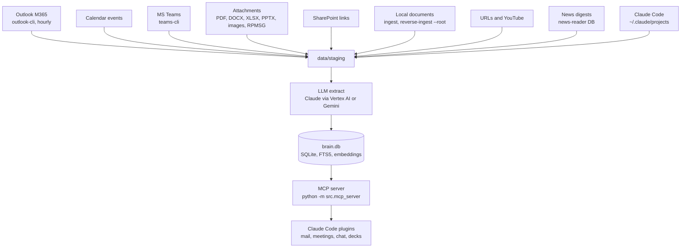

# second-brain

Personal knowledge repository and MCP data layer. It ingests emails, attachments, calendar events, Teams messages, SharePoint documents, news digests, and Claude Code conversation history into a SQLite database (`brain.db`), then exposes that store to Claude Code plugins via a Model Context Protocol (MCP) server.

The point: give the agent recall over years of institutional context (people, decisions, action items, topics, key facts) without re-reading every message on every turn.

[](https://github.com/weirdapps/plessas-second-brain/actions/workflows/ci.yml)
[](LICENSE)

Python 3.12+. MIT-licensed. Maintained by [@weirdapps](https://github.com/weirdapps).

## What it does

Four stages, run on a schedule:

1. **Ingest.** Pull new mail, attachments, calendar events, Teams messages, SharePoint links, standalone documents, URLs, YouTube transcripts, news digests, and Claude Code conversations into `data/staging/`.
2. **Extract.** Send raw content through an LLM (Claude via Vertex AI by default; Gemini optional) to produce structured JSON: summary, sentiment, urgency, topics, decisions, action items, people, key facts.
3. **Load.** Write rows into SQLite with FTS5 full-text indexes, embedding vectors, and thread reconstruction. Schema migrations run automatically.
4. **Serve.** Expose the store as MCP tools that Claude Code plugins (`mail`, `meetings`, `chat`, `decks`, and more) call directly.

## What changed on 2026-10-11

The changes merged on 2026-10-11 (#181 to #216) that you will notice, and the switch that gives the old behaviour back where there is one. A store built before then also wants a few one-off commands: [`docs/DEPLOY.md`](docs/DEPLOY.md), section 12, lists them in order.

| Change | What you notice | The old behaviour |
| --- | --- | --- |
| Reading moved to `brain tool` | `brain tool NAME 'JSON'` calls any MCP tool. The seventeen read commands (`query ...`, `prep`, `stale`, `stats`, `teams-search`, `teams-thread`, `teams-chat`, `teams-stats`, `sharepoint-refused`) answer with that tool's JSON instead of text, and print one deprecation line ([table](#deprecated-read-commands)) | They go in the next release |
| One-off maintenance under `brain maint` | `migrate`, `classify-sources`, `reextract`, `calendar-sync --backfill` and the other one-offs print one deprecation line under their old names ([list](#one-off-maintenance-brain-maint)) | The old names work until the next release |
| News and automation left out | Every tool that reads mail, or what was extracted from it, leaves out news items and the reports your own jobs mail you ([details](#news-and-automation-are-left-out-by-default)) | `include_news=true`, `include_automation=true` on the call |
| Your addresses matched whole | `BRAIN_USER_EMAIL_PATTERN` is a list of your addresses, each matched exactly, no longer as a substring: an alias it does not list is someone else ([Identity](#identity)) | None: list every address you send from, then run `brain maint classify-sources` |
| A 40,000-character answer | Ten tools hold their answer to 40,000 characters and name what they cut in `truncated` ([MCP tools](#mcp-tools)) | None: narrow the query or lower `limit` |
| One envelope on every row | Every result opens with `data_as_of` and `stale`; every row says its `kind`, `who`, `ref` and `date`, and a search hit its `matched_in`. `source` on email search rows is deprecated in favour of `matched_in` ([MCP tools](#mcp-tools)) | The fields a row already had stay beside the new names; `source` goes in the next release |
| `recall` dossiers on request | `recall` attaches the person and topic dossiers only when asked ([Unified recall](#unified-recall)) | `include_context=true` |
| Greek words in any form | A Greek keyword also finds the word's other forms: `κάρτες` finds `κάρτα` ([details](#greek-words-are-matched-in-any-form)) | `BRAIN_QUERY_STEMMING=0` |
| People resolved to identities first | A name resolves to someone known by an address, a Teams MRI or a WhatsApp JID before a name only seen in text; `resolved_by`, `match_count` and `other_candidates` say how ([People and topics](#people-and-topics)) | None |
| Your own sessions only | Conversation tools leave out agent sessions; `recall_preference` and `recent_conversations` are removed, which leaves 25 tools ([details](#claude-code-conversation-memory)) | `include_agents=true` for agent sessions; none for the two tools |
| Calendar | Each event lists 12 attendees, you and the organiser first; an invitation is summarised as its purpose and agenda, with no decisions or actions ([Calendar](#calendar)) | `max_attendees` up to 500; none for invitations |
| Claude settings required | `CLAUDE_EXTRACT_MODEL` and `VERTEX_SDK_REGION` have no default, so the first Claude call stops until both are set; `ANTHROPIC_API_KEY` alone no longer selects the direct API ([Extraction engine](#extraction-engine)) | `BRAIN_ALLOW_DIRECT_API=1`, with no Vertex project, for the direct API |
| Embeddings through the Gemini API when a key is set | With `GEMINI_API_KEY` in the environment, the index and every search query are embedded through the Gemini API, not Vertex (the same model) | `BRAIN_EMBED_BACKEND=vertex` |
| Attachments in the hourly sync | Newest mail first; images and zip archives wait for the nightly pass while one runs ([details](#attachments-in-the-hourly-sync)) | `BRAIN_SYNC_HEAVY_ATTACHMENTS=1` |
| Long attachments | A spreadsheet is summarised from a digest of its structure; any other long text from every part up to 8 parts and from three parts above that, where up to 50 were read ([details](#attachment-summaries-and-spend)) | `BRAIN_ATTACHMENT_FULL_PARTS_UPTO` raises the threshold; `brain maint reextract --full-parts ID` gives one attachment up to 50 parts |
| Card numbers, IBANs and passwords | Masked before the model sees them, and again at load ([Security](#security)) | None |
| Greek OCR | Scans and images are read Greek first; a reading that is Greek in Latin look-alike letters is marked and not summarised ([details](#greek-read-as-latin-letters)) | None |
| The health check judges more | New rows for the query path, per-folder mail lag, attachment lag, backups and the restore drill, mail loss and model spend; a STALE among them fails the freshness ping ([`docs/DEPLOY.md`](docs/DEPLOY.md#7-health-check-optional)) | `BRAIN_HEALTH_FOLDER_LAG_HOURS` sets a folder's limit; 0 stops judging it |

New settings: `BRAIN_ALLOW_DIRECT_API`, `BRAIN_EXTRACT_CALL_SHAPE` (`v1`, the default, builds the requests as before), `BRAIN_QUERY_STEMMING`, `BRAIN_SYNC_HEAVY_ATTACHMENTS`, `BRAIN_ATTACHMENT_FULL_PARTS_UPTO`, `BRAIN_ATTACHMENT_TOKEN_BUDGET`, `BRAIN_CHARS_PER_TOKEN`, `BRAIN_BATCH_BUCKET` and `BRAIN_BATCH_LOCATION` ([Configuration](#configuration)); `BRAIN_DAILY_SPEND_WARN_USD`, `BRAIN_HEALTH_FOLDER_LAG_HOURS`, `BRAIN_HEALTH_QUERY`, `BRAIN_BACKUP_DIR`, `BRAIN_BACKUP_OFFSITE_DIR`, `BRAIN_RESTORE_DRILL_STAMP`, `BRAIN_MCP_URL`, `BRAIN_MCP_PROBE_SLUG` and `BRAIN_MCP_PROBE_MAX_AGE_HOURS` for the health check and the backups ([`docs/DEPLOY.md`](docs/DEPLOY.md), sections 7 and 9). The MCP server also reads an owner-only environment file of its own ([Run the MCP server](#run-the-mcp-server)).

## Architecture



## Ingestion sources

| Source | Module | Notes |
| --- | --- | --- |
| Microsoft 365 mail | `src/export/outlook_export.py` + `outlook_cli.py` | Primary. Hourly through the day (the reference timer runs at :10 past 01 and 07 to 22), one `--since` cursor per folder. |
| Attachments | `src/export/outlook_attachments.py`, `src/extract/attachment_extractors.py` | PDF (PyMuPDF), DOCX (`python-docx`), PPTX (`python-pptx`), XLSX (`openpyxl`), XLSB (`pyxlsb`), XLS (`xlrd`), images (Tesseract OCR, Greek first and English first again for a page that reads as Latin script, a grayscale second pass when colour finds too little; the scanned pages of a text PDF are OCR'd too), EML and clear-signed `.p7m`, `.mso` object containers (the workbooks behind charts pasted into mail), `.wmz`/`.emz` drawings (their text records), and text formats routed by their bytes (ICS, VCF, XML, SVG, EPS, VTT). Files encrypted at rest (rights-protected Office files and `.rpmsg` messages, password-protected Office files and PDFs) are recognised from their bytes and recorded as `extraction_status = 'encrypted'`, method `rms`, `rms-message` or `password`: nothing reads them without the key. |
| Inline email images | `src/extract/image_classifier.py`, `image_pipeline.py`, `image_vision.py` | Dimensions plus bytes plus sender-scoped SHA256 dedup cascade; vision LLM stage for content images, cached by SHA256. |
| Calendar events | `src/export/calendar_export.py`, `src/extract/calendar_extractor.py` | Outlook events with attendees and series; an invitation's purpose and agenda, a past meeting's decisions. |
| MS Teams | `src/export/teams_cli.py`, `teams_export.py`, `src/extract/teams_pipeline.py` | Chats, threads, messages, MRI resolution. |
| WhatsApp | `scripts/whatsapp_snapshot.py`, `src/export/whatsapp_export.py`, `src/extract/whatsapp_pipeline.py` | A minimized snapshot pushed hourly from the Mac that runs a WhatsApp bridge; sessions extracted and embedded like Teams threads. See [WhatsApp](#whatsapp). |
| SharePoint links | `src/extract/sharepoint_url_scanner.py`, `src/export/sharepoint_fetcher.py` | Managed host defaults to `contoso.sharepoint.com` (override via `SHAREPOINT_HOST`). |
| Standalone documents | `src/cli.py ingest`, `reverse-ingest`, `src/ingest/reverse_scan.py` | Latest-version-per-logical-name dedup. `reverse-ingest` scans only the directories you name with `--root`; nothing schedules a scan. A file whose bytes are already stored is skipped with its reason: ingested before, or held by an attachment whose text is stored (`attachments.sha256`), such as a mail attachment saved into a folder. A twin that failed, was skipped, is encrypted or was read in part does not stop it. |
| Web and YouTube | `src/extract/web_ingest.py` | URL fetch plus transcript pull via `youtube-transcript-api`. |
| News digests | `src/export/news_export.py` | Reads an external news-reader SQLite DB (`BRAIN_NEWS_DB`) read-only. Digest syntheses plus articles at or above `--relevance`. Landed under `mailbox_name = 'News'`, so mail counts exclude them. Not sent to the model: the summary is the synthesis's brief or the article's opening, the topics its section categories or the article's categories (`src/extract/news_extract.py`). |
| Claude Code sessions | `src/export/conversation_export.py` | Reads `~/.claude/projects`, sent there from a workstation when each session ends (`scripts/hooks/session-end-push.sh`, see DEPLOY). A turn is the owner's only when he typed it; agent sessions are left out unless `--include-agents`. |

### Bring your own source

The extract → load → serve chain is **source-agnostic**: it only reads staging batches from `data/staging/batch-*.json`. The Microsoft 365 adapters above are just one way to fill that folder. To ingest from any other system (Gmail, IMAP, an `.mbox`, a custom API), write a small exporter that emits the same JSON shape. No other code changes are needed.

A staging batch is `{ "batch_number", "exported_at", "source", "folder", "emails": [ … ] }`, where each email record is:

```json
{
  "message_id": "any-stable-unique-id",
  "date_received": "2026-01-15T09:00:00Z",
  "subject": "…",
  "sender":        { "name": "…", "address": "…" },
  "to_recipients": [{ "name": "…", "address": "…" }],
  "cc_recipients": [],
  "mailbox_name": "Inbox",
  "content": "plain-text or HTML body",
  "conversation_id": "optional, for threading",
  "internet_message_id": "optional, for cross-source dedup"
}
```

An HTML `content` is recognised by how it opens: a document or block-level tag (or `span`, `font`, `br`, `img`), a comment, a doctype, or an XML prolog followed by one of those; `looks_like_html` in `src/extract/html_text.py` has the list. It is stored as the text a reader sees, with the markup kept beside it; a body that opens with text is stored as it came.

See [`examples/example_exporter.py`](examples/example_exporter.py) for a ~40-line reference exporter and [`examples/sample-batch.json`](examples/sample-batch.json) for a complete synthetic batch. Drop a batch into `staging/` under the data home (`<repo>/data` unless `BRAIN_DATA_DIR` moves it). On a fresh store, run `python -m src.extract.local && python -m src.cli load`: `load` creates the database but does not extract, and `sync` needs the database to exist. From then on `python -m src.cli sync` does both.

## MCP tools

The MCP server exposes 27 tools (all defined in `src/mcp_server.py`), five of them deprecated ([below](#deprecated-tools)). Register the server once with `claude mcp add` (see [Register with Claude Code](#register-with-claude-code)), then every session picks them up.

**Loaded with the session.** Under tool search only the tool names and the server instructions load at session start, and a `ToolSearch` turn came first in 187 of 192 sessions that used the brain. `sql_query`, `search_emails`, `search_attachments`, `recall` and `stats`, which carry most calls (the first four 76% of them) or come first (`stats`), carry `_meta["anthropic/alwaysLoad"]: true`, so Claude Code loads them with the session. The server instructions stay under 4,000 characters, the 4,096 Claude Code keeps of them since v2.1.296 (it kept 2,048 before), and lead with routing: which tool first, `get_item` for reading, the sizes, what an empty answer means, how matching falls back and how a name resolves, and the deprecated tools.

**Response budget.** Claude Code saves a tool result longer than 50,000 characters to a file and hands the model a path instead. Every tool that can return a list therefore holds its answer to 40,000 characters, measured on the indented JSON the server sends, header and row envelope included (`src/mcp_budget.py`). Until this change ten did, and `stale_threads` once returned 5,366,123 characters, `query_calendar_events` 272,098; `person_context`, `topic_context`, `meeting_prep`, `outlook_live_search` (up to 500 messages), `email_thread`, `teams_thread_context`, `conversation_context`, `teams_chat_summary`, `attachment_image_search`, `sharepoint_index` and `sender_brief` had no character bound. Over the budget, rows are cut from the tail of whichever list holds the most characters, and `truncated` names each list that lost rows as `{"kept": n, "total": m}`; ask again with a narrower query or a lower `limit` for the rest. `meeting_prep` cuts inside each attendee's dossier, which then says what it lost in its own `truncated`, so no attendee is dropped whole. `sql_query` keeps its own caps and its `truncated` flag, and cuts rows from its tail to fit. `search_emails`, `query_emails`, `search_attachments`, `search_conversations`, `query_decisions` and `query_actions` return their rows as `{"result": [...]}`, which is also what their structured content always was (`query_actions` returned a bare list until #139).

**`detail`.** `recall`, `person_context`, `topic_context` and `meeting_prep` take `detail`: `full` (the default, as before) or `concise`, one short line per row and the answer held to 10,000 characters. A concise row keeps the envelope (`kind`, `ref`, `date`, and `who` as the name alone), the flags and people a caller acts on (`partial_match`, `overdue`, `owner`, `deadline`, `status`, `decided_by`, `by_person`), counts (`count`, `email_count`, `message_count`, `thread_matches`, `older_editions`), and the first of its subject, filename, title, decision, task, commitment, fact, topic, name, chat name, image description or summary, cut to 80 characters; snippets, summaries and every other field are left out, and `get_item` reads the row whole. `recall`'s median answer was 32,500 characters after the budget; on a replica's real queries at `limit_per_kind` 5 to 8, its concise rows came to 7,000-15,000 characters of compact JSON before the 10,000 cap, against 27,000-55,000 in full. `person_context` also takes `detail="card"`: the short card `sender_brief` gave (known or not, role, mail count, top topics, decision and open-action counts, last contact).

**An empty answer says why.** Every empty list a tool returns carries `reason` and `coverage`: for each source the call searched, the first and last date the store holds and how many items, read as `stats` reads them (`src/store/query.py` `get_coverage`, plus the attachments' span, dated by their emails), so "nothing found" reads as "nothing in mail between A and B". The sources are `mailboxes` (per mailbox), `attachments`, `teams`, `whatsapp`, `calendar` (with its `incomplete` months, without the month by month counts) and `conversations`; `outlook_live_search` gives the window it read as `live_mailbox`, `sharepoint_index` the links it holds, and `sql_query` the sources of the tables its query names. A dossier counts as empty when the person, topic or attendees were not found or nothing was held of them in the window; `recall` when no bucket has a row. The spans are read once per store file and kept 15 minutes (`src/mcp_coverage.py`): over emails they took more than a second on a replica read cold. Agents read an empty answer as "it does not exist": in six weeks, 87 of the 105 calls that followed one moved on to another topic.

**`excluded`.** News and the owner's automation mail are left out by default ([below](#news-and-automation-are-left-out-by-default)), and nothing said a match had been. `search_emails`, `query_emails`, `search_attachments`, `query_decisions`, `query_actions` and `recall` now say, under `excluded`, how many matches of each class they left out and the switch that lets them in: `{"automation": {"rows": 3, "switch": "include_automation=true"}}`, with `at_least: true` when the count stopped at 50, the most the count reads. It is `{}` when nothing was left out, and absent when the call let every class in (or named only `kinds` no left-out class belongs to). The count is the same search run once more over the left-out classes, which adds 0.02-0.2 s on a replica (the same keyword match in semantic `search_emails`, which would otherwise embed the query twice; the best 50 matches with every class in for `search_attachments`, `query_decisions` and `query_actions`, which take no class filter); `recall` counts its emails and attachments buckets. When only left-out matches were found, the `reason` says so first.

**Freshness, on every result.** Every result opens with `data_as_of` and `stale` (`recall` after its `summary`), read as `stats` reads them: the older of the last `sync` and the Inbox export's last success. When the store is more than 3 hours behind, `_stale_warning` follows with the sentence to pass on. `outlook_live_search` reads the live mailbox, so its `data_as_of` is the time of the call and `stale` is `false`. Until #139 only `recall` and `stats` said this, so a replica hours behind answered every other tool like a store in which nothing had happened since.

**The row envelope.** Every row a search or a list returns says what it stands for, under the same names in every tool (`src/store/envelope.py`):

| Field | What it holds |
| --- | --- |
| `kind` | `email`, `news`, `document`, `attachment`, `teams`, `whatsapp`, `calendar`, `conversation` or `image`. A decision, action, commitment or key fact takes the kind of the item it was taken from, and the rest of its envelope describes that item. |
| `mailbox` | The email's folder (an attachment's: its email's), only where the kind has one. |
| `who` | The sender, author or organiser as the store has them: `Name <address>`, or whichever of the two it holds; `null` when it holds neither. A Teams or WhatsApp row names the sender of the message that matched, else whoever wrote first in the thread. |
| `ref` | The id `get_item` takes with the row's `kind`: `emails.id`, `attachments.id`, `teams_threads.id`, `whatsapp_threads.id`, `calendar_events.id`, a conversation's `session_id`, an image's `sha256`. |
| `date` | The item's own date as stored: the email's arrival, the meeting's or the session's start. A decision keeps its own date. |
| `ingested_at` | When the store took the item in, only where it records that: an attachment's export, a calendar event's ingest, a conversation's load. The store keeps no such time for mail, Teams or WhatsApp. |
| `matched_in` | On a row a search matched, the field the words matched in: an email's `subject`, `summary`, `content`, `mixed`, `key_fact` or `attachment`, a Teams or WhatsApp `thread` or `message`, a conversation's `summary` or `turn_content`, or `semantic`. |

A field a row already had stays beside its new name: `email_id`, `thread_id` and `id` beside `ref`, `start_at` and `started_at` beside `date`, `match` and `match_type` beside `matched_in`, and under `include_agents` a conversation row's `kind` stays `owner` or `agent`. The parts a context tool reads of one item (`teams_thread_context`'s messages, `conversation_context`'s turns, a chat summary's last messages) carry no envelope.

**Deprecated: `source` on search rows.** An email search row's `source` named the field the words matched in, which `matched_in` now says; it stays for one release and is then dropped from search rows. On decision and action rows `source` is the kind of the item they were taken from (`email`, `teams`, `whatsapp`, `calendar`, `conversation`) and stays.

**`kinds`.** `recall`, `search_emails` and `query_emails` take `kinds`, a list of row kinds: only rows of those kinds come back, chosen in the query before its limit, so a page of mail no longer crowds out the one document asked for. `recall` skips the buckets none of whose rows can be one, and keeps the decisions, actions and commitments taken from an item of a kind named (one whose item is gone comes back only without `kinds`). Keyword `search_emails` takes `email`, `news` and `document`; semantic mode takes `attachment`, `teams`, `whatsapp` and `conversation` too. There is no `exclude_news`: news is left out unless `include_news` is set, and naming `news` in `kinds` lets it in.

**Shape snapshot.** `tests/fixtures/mcp_shapes.json` holds every tool's output schema keys, the keys of a sample result in order and the keys of each of its lists of rows, read against a store holding an item of every kind. A change to any of them fails `tests/test_mcp_shapes.py` until the snapshot is regenerated with `SNAPSHOT_UPDATE=1`, so the diff of that file is the review of the change. Add fields; rename or remove one only after a release of notice here.

**Contract.** Every tool is annotated read-only, idempotent and closed-world, so a client may run several at once, except `outlook_live_search` (open-world: it reads the live mailbox) and `sharepoint_index` (open-world, and not read-only: `refetch` fetches from SharePoint and records what it fetched). Choices are enums and every `limit` has bounds in the input schema, so a bad value is refused before the tool runs. Every tool declares an output schema (`src/mcp_results.py`), so results also go out as compact `structuredContent`. A failure (a malformed argument, an unknown id, a missing filter, a refused SQL statement) is a tool error, `isError: true`, whose message says what to do next; "nothing matched" is an empty list with a `reason` and `coverage`.

**A crash says what happened.** The SDK sends a client only `Error executing tool <name>` for an exception that is not a deliberate tool error, and for a result that fails the tool's own output schema; ten calls in six weeks came back that way, seven of them on 11-13 Oct. `BrainServer.call_tool` (`src/mcp_server.py`) catches every such failure, logs its traceback on the server's stderr, and sends `Error executing tool <name>: <Type>: <message>. <next step>`: restart the server when its code changed on disk under it, wait for the pull when the store cannot be read, say which field broke the output schema, and otherwise retry once or read the store through `sql_query`, never mistaking the failure for an empty answer. `brain tool` prints the same words. The cause of the 11-13 Oct failures was a server running for hours while a pull rewrote `src/` under it: a module its tools imported for the first time after that mixed new code with old copies in memory (the new `query.py` asking the old `greek.py` for `query_stem`). The server now loads every module its tools import at start, and `tests/mcp/test_eager_imports.py` fails when a new one is not on that list.

**Connections.** Every tool but the `sharepoint_index` refetch reads through one read-only open (`connect_read_only`, `src/store/sql_readonly.py`, to which `sql_query` and `sql_schema` add their caps), so a write through it raises. It opens `mode=ro` with SQLite's locking, which the producer needs because its timers write the file it serves; only a pulled copy (the pull stamp exists and `BRAIN_ROLE` is not `producer`) is opened `immutable=1`, as the server asks there, or when a locking open fails there. Writers open through `get_connection` with `secure_delete` on, so what they delete is zeroed rather than left in free pages; on a replica it returns the read-only connection instead.

### News and automation are left out by default

Every row of the `emails` table has a `source_class` (schema v33; the rules are under [Database schema](#database-schema) and in `src/store/source_class.py`): `mail`, `automation` (the reports your own jobs mail you), `news`, `document` (standalone documents, SharePoint files and pages, web imports) or `session_note` (notes Claude sessions wrote). Every tool that reads mail or what was extracted from it (`recall`, `search_emails`, `query_emails`, `person_context`, `topic_context`, `meeting_prep`, `query_decisions`, `query_actions`, `stale_threads`, `search_attachments`, and `sender_brief` through `person_context`) leaves out `news` and `automation` unless you pass `include_news=true` or `include_automation=true`. Documents and session notes stay in. Every row drawn from an email carries its `source_class`; a decision or action whose parent is not an email (Teams, WhatsApp, a meeting, a conversation) carries `null` and is never filtered. On a store older than v33, as a replica's is between new code and its next pull, only `news` is left out; `recall`'s `summary.source_class` and `stats` say so.

This changes results: decisions, actions and key facts from news items and from your automation mail no longer appear in "what did we decide" or "what do I owe" answers unless asked for. Before v33 only `query_decisions`, `query_actions` and the overdue half of `stale_threads` left out news, and nothing left out automation.

Since schema v35 the loader takes no decisions, action items or commitments from news or automation mail at all (`takes_items` in `src/store/source_class.py`): a digest or a job's report decides nothing for you and owes no one anything. Their key facts and topics are still stored, with the email's class. What earlier code took from them stays until `python -m src.cli maint forget-itemless --apply` deletes it ([One-off maintenance](#one-off-maintenance-brain-maint)).

### Greek words are matched in any form

Every keyword search finds a Greek word in its other forms: `κάρτες` also finds `κάρτα`, `κάρτας` and `καρτών`, and `έγκριση` finds `εγκρίσεις`. Only the form typed used to match, which on one store missed half to two thirds of a word's uses (`καρτες` was in 3,966 emails, some form of the word in 13,243). This covers `search_emails` in keyword mode, `query_emails` with `keyword`, `search_attachments`, `search_teams`, `search_whatsapp`, `search_conversations`, `query_calendar_events` with `keyword`, `attachment_image_search` and every `recall` bucket.

It works on the query alone; the index is unchanged. A Greek word of four letters or more is folded (case, accents, final sigma) and searched also by its Snowball stem ([`snowballstemmer`](https://pypi.org/project/snowballstemmer/)) as a prefix, `("καρτες" OR "καρτ"*)`, when the stem is shorter than the word, starts it and has four letters or more. Any other word is searched as typed, and so are stopwords, Latin words, codes and numbers. Every word is still required, and the any-word fallback (`partial_match`) uses the stems too. The decision, action, commitment and image buckets, which match in Python, look for the same stems, and the phrase `search_teams` and `search_whatsapp` try first holds in any form. The form typed stays in the query, so within each stage it ranks above the other forms.

The price is precision, since a stem can start a different word: `πλήρης` (`πληρ`) also finds `πληροφορία` and `πληρωμή`, `χρήση` finds `χρήστες`, `σχέδια` finds `σχεδόν`, a first name finds the names that start like it, and a few words share a stem outright (`τράπεζα`, `τραπέζι`). Measured on one store's most frequent Greek words used as one-word queries, a search found 77% of the emails holding some form of the word before and 100% after, and 90% of what it found held one.

`BRAIN_QUERY_STEMMING=0` turns it off for one deployment, and every word is searched as typed, as before. Set it where the searching process reads its environment; for the MCP server that is `$BRAIN_DATA_DIR/env` or `~/.second-brain/env` (see [Run the MCP server](#run-the-mcp-server)). A checkout updated without `uv sync`, and so without `snowballstemmer`, searches as typed too and logs a warning saying why.

The prepositions `ανά`, `κατά`, `προς`, `μέσω` and `έως` are stopwords, which a row need not hold: `πωλήσεις ανά κανάλι` missed the weekly report that never says `ανά`.

### Newest first, one row a report

Keyword search ranked by text relevance alone, the date only breaking ties, so a report mailed every month matched its own name as well in every edition and the older ones led: on one store the newest edition of a monthly KPI workbook came 18th and 19th for its own name, behind five older editions, where recall's five attachment rows never reached it. Now `search_attachments`, `search_emails` in keyword mode and the `recall` buckets rank their best matches by relevance (the best 4 per row asked, at least 40 and at most 100, never fewer than asked) a second time newest first, and fuse the two lists by reciprocal rank fusion, recency at equal weight (`src/store/ranking.py`, `src/store/fusion.py`). Recency reorders the matches the words found and adds none. `search_emails` keeps its stages (subject, summary, body, key facts, attachments): recency reorders the rows inside each, so an old email whose subject holds the words still comes before newer mail that mentions them in the body.

Items whose name differs only by a date, a period or a version are one series, and so are copies of one file:

| | One series |
| --- | --- |
| Filenames | `Report 31.08.2026.xlsx` and `Report 31.07.2026.xlsx`; `KPIs August 2026.pptx` and `KPIs September 2026.pptx` (English and Greek month names); `Q3 2026 results.pdf` and `Q2 2026 results.pdf`; `deck v3.pptx`, `deck final.pptx` and `deck.pptx`; `Budget (1).xlsx` and `Budget (2).xlsx`; any two attachments with the same `sha256` |
| Subjects | the same, after their `Re:` and `Fwd:` prefixes: `Daily dashboard 15/10/2026` and `RE: Daily dashboard 14/10/2026` |
| Never | `image003.png` twice with different contents (no date, no version), `Report.xlsx` and `Report.pdf` (another extension), a name holding nothing but a date |

Once a name holds a date, its other numbers of up to four digits count as part of it (the `9` of `Tue 9 JUN`); a longer number is a reference and keeps two invoices apart. A series is ranked once, by its best match and its newest date, and shown by its newest member, preferring an edition's own mail to a later reply to an older one and, on the same day, a version named final. The row says `older_editions: n` and lists the others' refs in `editions`, newest first. A query that names a date (`31.05.2026`) is shown the member whose name holds it. The page is cut after the collapse, so five rows are five series. On the store above the newest edition now comes 3rd, standing for ten older rows.

`BRAIN_QUERY_RANKING=relevance` turns recency and the series off for one deployment, and in `recall` only the email bucket fuses semantic search, as before.

### Names in either script

Most mail is Greek and most queries are not: in six weeks of use 53% of query text was English or Latin only and 27% mixed, and agents retried about 60 searches by translating a surname from Latin into Greek letters by hand. Now a query word of four letters or more, in one script, that is a word of a name the people table holds in the other script, by the spelling keys person resolution uses (`src/store/transliterate.py`), is searched in those forms too: `Okapidis` is `("Okapidis" OR "οκαπιδ"*)`, a Greek form by its stem where it has one, at most three forms a word, the most frequent first (`src/store/cross_script.py`). The reverse holds: `Οκαπίδης` also finds `Okapidis`. Every full-text search takes it: `search_emails`, `query_emails`, `search_attachments`, `search_teams`, `search_whatsapp`, `search_conversations`, `query_calendar_events` and the `recall` buckets that search the full-text index. The decision, action, commitment and image buckets, which match in Python, do not.

A word no name holds in the other script is searched as before: of 180 common query words on one store, 3 had a form, each its own transliteration (a system's name, an English loan word and a first name). Measured on 60 Latin-script surnames of addressed people there, `search_emails` came back empty for 2 before and none after and returned 14.3 rows of 20 on average before and 19.3 after; paired with a Greek word, 12 queries found only partial matches before and 1 after; `search_attachments` came back empty for 11 before and 1 after. Greek surnames gained less (empty 1 to 0 in mail, 3 to 1 in attachments): Latin-script mail names people less often. The forms are built once per store and process from the people index (under half a second for 34K people), and again when the people table changes. `BRAIN_QUERY_NAMES=0` turns it off.

### Unified recall

- `recall(query, limit_per_kind, days, include_context, include_news, include_automation, kinds, detail)`. Fan-out across every text-bearing index. This is the default "tell me everything you know about X" entry point. `detail="concise"` gives a short line per row ([`detail`](#mcp-tools)), and `excluded` counts the emails and attachments the class filter left out.

  Ten result buckets, keyed exactly as returned: `emails` (which also covers standalone documents and news, since they share the `emails` table), `attachments`, `conversations`, `decisions`, `actions`, `commitments`, `inline_images`, `teams`, `whatsapp`, `calendar_events`. `summary.kinds_with_results` names the ones that matched.

  The answer leads with what decides how far to trust it: `summary` (its first key `semantic`), then `data_as_of` and `stale`, then `_stale_warning` when the local database is behind, then `truncated` when the budget cut rows, and only then the buckets. A result too big to show inline used to end with these, where the preview of the saved file could not see them. `limit_per_kind` is 1 to 10 (default 5). Rows carry summaries cut to about 300 characters, and no `snippet` that only repeats the row's subject, title or summary.

  `include_context` (default `false`) attaches the person and topic dossiers the query matches, as `person_context` and `topic_context`, with `summary.has_person_context` and `has_topic_context`. They used to be attached to every call: 27% of an average payload, often for the wrong entity, since a topic word can start a person's name. The person dossier comes only when the query is an address, a Teams MRI or a WhatsApp JID, or a name that fits one person (`match_count` 1, rows the alias map joins counting once); a surname that fits several people used to attach whichever was most emailed. Call `person_context` or `topic_context` directly for a full dossier.

  The buckets that have vectors, `emails`, `attachments`, `teams`, `whatsapp` and `conversations`, are each a reciprocal rank fusion of their keyword hits, ranked with recency (see [Newest first, one row a report](#newest-first-one-row-a-report); Teams and WhatsApp hits come newest first already, conversations get a recency list in the fusion), and the semantic hits of their kind. One query vector serves them all: `semantic_email_candidates` ranks the attachments, Teams threads, WhatsApp sessions and the owner's conversations by it beside the emails. A row semantic search alone found says `matched_in: semantic`, and counts as neither a whole nor a partial match in `summary.partial_kinds`. `summary.semantic` is the one status for every bucket; when the semantic half is unavailable, every bucket is keyword-only. Decisions, actions, commitments, images and calendar events are keyword-only. Before this only the `emails` bucket fused, and the other buckets' vectors, in the index all along, went unused: on the 45-question qa set below, recall's recall@10 rose from 0.62 to 0.78 and its MRR from 0.59 to 0.70, documents from 0.33 to 0.67.

  Replies of one thread embed close together (cosine 0.89 against 0.66 for two random emails), so of the 20 semantic candidates a bucket fused about a third were siblings, which the fusion then collapsed into one row. Each bucket now takes three candidates per slot, collapses them onto their thread (for mail with a dated subject, its series) and only then keeps its 20: on 200 probe vectors from the store the pool held 13.5 distinct threads on average before and 18.6 after.

  The buckets run at once (`BRAIN_RECALL_WORKERS`, default 6), each on its own read-only connection (`src/store/sql_readonly.py`), the semantic half first, so its embedding call overlaps the keyword buckets. With a 0.6-second embedding on the replica, a call took 1.24 s (median of 20) before this change and 1.03 s after, with every bucket now fused; with the new ranking, running the buckets at once instead of one after another cut the slowest of eight calls from 4.6 s to 2.5 s. A process's first call also builds the name forms and opens its first connections, about 2.5 s once. The result is the serial run's. A store in memory, which no other connection can open, and a connection with a transaction open, whose rows no other connection sees, run serially.

  News and automation are left out of every bucket, the semantic candidates and both dossiers unless included (see above).

  A search embeds its query with a 4-second timeout and at most one retry (a 4xx other than 429 is not retried), never the ingest job's two-minute backoff. When the query cannot be embedded, semantic search ranks around the vectors of the query's best keyword matches instead, and says so: `summary.semantic` in `recall`, and each row's `semantic` in `search_emails` and `search_conversations`, read `keyword_seeded: <error type>`. With no keyword match to stand in, `recall` reports `unavailable: <error type>` and stays keyword-only.

  The same happens when this code would embed the query into another space than the index's (another model or task type, or a vector of another dimension; see Vector index under [Database schema](#database-schema)): the row reads `keyword_seeded: IndexSpaceMismatch`, and the server's stderr says which part differs. A query is embedded as typed, so an index built from another text template still takes it.

### Emails

- `search_emails(query, search_type, limit, include_news, include_automation, kinds)`. Keyword (FTS5) or semantic (embedding). Keyword search tries the subject first, then the summary, the body, key facts and attachments, and returns one email per thread (for a subject match, the thread's newest); a row whose thread has more than one email matching in its subject, summary or body says how many in `thread_matches`. Inside each stage its rows are ranked with recency, and mail whose subject differs only by a date is one row, the newest edition, with `older_editions` ([Newest first, one row a report](#newest-first-one-row-a-report)); a name matches in Latin or Greek letters ([Names in either script](#names-in-either-script)). Key facts marked boilerplate (schema v35) are not searched. Semantic search leaves the vectors of news and automation mail, and of their attachments, out of the ranking unless included.
- `email_thread(email_id, limit)`. Deprecated, going in the next release: `get_item(kind="email", ref=email_id)` gives the same thread, 20 emails centred on the hit, with the email's body. The emails of a hit's thread, oldest first, with `thread_total`; a thread longer than `limit` comes back as the `limit` emails centred on the hit, and a News item or an email with no conversation id as a thread of one. The thread asked for comes back whatever its class, each row saying its `source_class`.
- `query_emails(person, topic, keyword, start_date, end_date, limit, include_news, include_automation, kinds)`. Combined filters.
- `outlook_live_search(folder, since_minutes, subject_contains)`. Bypasses the DB and queries the live Outlook mailbox directly, for mail newer than the store. `since_minutes` defaults to 60 and is capped at 1440 (24 hours); the answer's `since_minutes` and `clamped` say what was searched. This is the escape hatch when `stats` says the local copy is stale. When Outlook needs a new sign-in (outlook-cli exit 4), or outlook-cli fails, the error says so and points at the brain's own copy.

Mail deleted or junked in Outlook keeps the folder it had, where it used to be relabelled `Archive` like mail moved there; where it went, and when it was first seen deleted, is recorded beside it (see [Database schema](#database-schema)). Nothing is removed from the store: these tools still return it.

### People and topics

- `person_context(name_or_email, days, limit, include_news, include_automation, detail)`. `detail` is `full`, `concise` or `card` (the card `sender_brief` gave). History, sentiment, decisions, open actions, communication pattern, `teams`: the messages they wrote in the window and the threads they wrote in (`recent_threads`, with `recent_threads_total`), and `whatsapp`, the same for WhatsApp, matched on a name of two words or more against sender names, since WhatsApp has no address to join on. Each list is capped at `limit` (default 20) and carries a `<name>_total` sibling with the real count, so a truncated answer is distinguishable from a complete one. An address, a Teams MRI or a WhatsApp JID resolves exactly; pass one when you have it. A name is matched ignoring case, accents and script, in the common romanisations of Greek ('Mprostopoulou', 'Brostopulu' and 'Μπροστοπούλου' are one name), each word at the start of a word in any order. A person known by an address, MRI or JID (an identity) is preferred over a name the model only extracted from text (a mention, 78% of the people rows on a large store), and an identity whose name shares the surname and contradicts no word of the query counts as a match ('Evi Surname' is 'E. Surname (Evanthia)' at `surname.evi@`); among those, the most-emailed is used. Every spelling of the owner (`BRAIN_USER_NAME`) and every address he lists (`BRAIN_USER_EMAIL_PATTERN`) resolves to one row, the busiest at a listed address; a name alone never makes a row the owner, and a row at an address he does not list is someone else. `resolved_by` says how the person was found (`email`, `mri`, `jid`, `name`, or `alias` for the alias map and the owner rule), `match_count` how many people the query fits, and `other_candidates` the next three with each one's `identifier` kind (`null` for a mention) (`sender_brief` and `meeting_prep` resolve names the same way).
- `topic_context(topic, days, limit, include_news, include_automation, detail)`. Key people, decisions, actions, facts. Same `limit` and `<name>_total` contract. When the topic has a page ([Topic pages and findings](#topic-pages-and-findings)), `topic_page` comes first, before the rows it was written from.
- `sender_brief(name_or_email, days)`. Deprecated, going in the next release: `person_context(name_or_email, detail="card")` returns the same card. Compact briefing suitable for inline display.
- `meeting_prep(people, topic, days, include_news, include_automation, detail)`. Per-attendee dossiers, optionally scoped to a topic, and `meetings`: the `next` and `last` meetings (three each, the last within `days`) that the people it resolved share with you, the ones most of them attend first, each with its `body_summary` (an invitation's purpose and agenda, see [Calendar](#calendar)), `is_recurring`, and at most 12 attendees as `query_calendar_events` lists them, those people kept among them. Pass each attendee's address when you have it: by display name, 42% of a month's attendees resolved to no one and a third of the rest to someone other than their address, before name resolution preferred identities (18% and 10% after).

The alias map joins mention rows to the identity they stand for, so that a name fitting a person's identity and their extracted spellings counts as one person. `python -m src.store.person_aliases` proposes, for each mention row, the one identity whose name agrees with it and with which it shares threads (at least half of them for a one-word name), and prints the proposals; `--apply` records them as `sync_metadata` rows (`person_alias:<mention id>` to the identity's id) on the host that builds the store. No people row is merged or changed, and a replica gets the rows with its next pull. Delete a row to undo an alias.

Every dossier dates and orders its rows the same way (`src/store/ordering.py`): decisions newest first by their own date when it is an ISO date, else by their parent's (the email, Teams or WhatsApp session, meeting or conversation they came from); key facts newest parent first; open actions upcoming first, soonest first, then undated, then overdue, most recently missed first. Every decision, fact and action row carries `date` and `parent_date`.

### Topic pages and findings

The owner comes back to a handful of live topics (in six weeks one budget topic came up in nine sessions over eight days), and a status question was the costliest he asked: a median of 18 brain calls, up to 49. Agents dug up earlier sessions 56 times. A page per live topic holds where it stands, so the next session starts there. Pages are few, cited, written again from the sources, and never a source themselves: a 43-page wiki tried in April 2026 lasted two days, and the practitioners' verdict on such wikis (July to October 2026) is that pages rot, a bad page becomes a prior, and a flat index breaks past 100-200 pages.

- `topic_page(topic)`. The page: `body` in markdown under Current status, Decisions (dated), Settled numbers (each with its period and source), Open questions, Deliverables produced and Superseded, every line ending with the items it rests on as `[kind:ref; ...]`, which `get_item` reads; `citations` lists each item cited with its kind, date and title; `built_at` and `newest_evidence_at` say how current it is. Then `findings`, the accepted findings filed about the topic, the owner's sessions' first (below). With no page, `topic_page` is `null`, `reason` says why and `pages` lists the topics that have one. Held to the 40,000-character budget.

**Which topics** (`src/store/topic_pages.py` `select_live_topics`), at most 20, in this order:

1. every page `BRAIN_TOPIC_PAGES` names: pages separated by `;`, the phrases of one page by `|`, the first naming it (`"budget 2027|business plan 2027; data platform"`). Topic tags fragment ("2027 budget", "exco budget 2027"), so a named page covers every tag holding all the words of one of its phrases, the 12 most used in the last 120 days;
2. topics the owner's own sessions came back to: three or more sessions in the last 30 days in which he typed a turn and called a brain tool (a teammate's or subagent's session never counts, and most of his sessions are coding ones whose tags are tools and hosts), with two or more of his discussion threads;
3. topics with the most of his discussion threads, three or more. A discussion thread holds two or more mail messages in the window, at least one sent by him or addressed to him; news, automation, documents, session notes and meeting responses do not count, and neither does a broadcast, one message a thread.

Both 2 and 3 must be live: the topic's share of its year's mail that fell in the last 30 days is at least twice the store's own share, so the employer's name, a unit's name or meeting logistics, present all year, get no page (the test is skipped while the store holds less mail before the window than in it). A tag that holds another picked tag's words joins its page (`okapi pilot results` joins `okapi pilot`). `BRAIN_TOPIC_PAGES_SKIP` (`;`-separated tags) keeps a tag from ever getting a page or joining one. A page whose topic is no longer picked is removed once it is 14 days old.

**What a page is written from** (`gather_evidence`): `topic_context`'s decisions, key facts, open actions and recent emails over 120 days for every tag the page covers, the newest attachment summaries, and the figures registry's latest values when it is installed (`src/store/figures.py`, cited by the attachment that holds the cell). Then, marked derived: the accepted findings (the owner's first), the owner's sessions on the topic (for open questions only) and the notes his sessions wrote about it (listed as deliverables, never read for facts). A session note's own rows are left out, and so is every page: no page is evidence for another.

**How** (`src/pipeline/topic_pages.py`): one call per page through `claude_extract.complete()`, plain text with the evidence fenced as third-party content and the reply plain JSON (the deployment's Vertex project refuses structured outputs), effort `medium`. A post-check keeps only the lines whose every ref was in the evidence given and drops the rest, counted in `lines_dropped`; a reply with no line left keeps the page held. A page is written again only when its evidence holds an item it was not written from, or the prompt changed (`prompt_hash`). Pages live in the `topic_pages` table (schema v37), which no full-text index and no vector reads.

```bash
python -m src.cli topic-pages --estimate          # the topics picked today, and what writing their pages costs; no model call (runs on a replica)
python -m src.cli maint topic-pages               # every page again, new evidence or not; --topic NAME for one
python -m src.cli topic-pages                     # what the nightly timer runs: only pages with new evidence
```

On a replica's store of 2026-10-16 the rule picked 20 topics (6 by sessions, 14 by mail); a page's evidence ran 46-101 items and 9,000-19,000 input tokens. Two real calls took 22 s and cost $0.04 each, every line kept. The first build is priced at about $1.15 (20 pages; the estimate counts 2,500 output tokens a page, the calls used 1,800), and in the week before 6 to 16 of the 20 had an item dated each day, so a night costs about $0.25-0.90.

**Findings.** A research session that settles a claim or a figure files it back in a ```` ```findings ```` block, in any `.md`, `.txt` or `.csv` note it writes. Notes are already ingested (`ingest-session-notes`, [Claude Code conversation memory](#claude-code-conversation-memory)); the block also loads, one JSON object a line, into the `findings` table (schema v37, `src/store/findings.py`), with the session id, the note's path and its date:

````text
```findings
{"claim": "Share of loan applications made online, year to date", "value": "64.0%", "as_of": "2026-08", "source_ref": "attachment:1234", "quote": "online applications 64.0% of the total"}
{"claim": "Monthly active app users", "value": "1.2M", "as_of": "2026-06-30", "source_ref": "email:5678", "supersedes": "finding:17"}
```
````

| Key | Holds |
| --- | --- |
| `claim` | What the finding states, 3 to 300 characters. Required |
| `source_ref` | The primary item it rests on, as a row's `kind:ref` (what `get_item` reads): `email:`, `news:`, `document:`, `attachment:`, `teams:`, `whatsapp:` or `calendar:`, with the row's id. Required |
| `value` | The settled value as the source writes it, at most 100 characters: a number, a percentage, a date |
| `quote` | Words copied from the source, 12 to 300 characters, holding the value |
| `as_of` | The date or period the value holds for, not in the future: `2026-08-31`, `2026-08`, `2026-Q3`, `2026` |
| `supersedes` | An earlier accepted finding with the same claim, whose source is older, as `finding:<id>` |

The agents that write notes read third-party mail, so a mail can make one write a block, and a finding fails closed. It is `accepted`, and only then shown, cited or given to a page, when every check passes; otherwise it is stored `rejected` with its `reason`, never shown, and listed for review by `python -m src.cli findings` (`--accepted` for the others; read-only, so it runs on a replica). The checks, line by line, in `src/store/findings.py`:

1. **Strict shape.** One JSON object a line with the keys above and no other, each of its type and length; a line that breaks one is rejected, never repaired, and the other lines of the block stand. A rejection's reason never quotes the line.
2. **A held primary source.** `source_ref` names an item the store holds. A finding, a topic page, a session (`conversation:`) or a session note is never a source, so no finding rests on another.
3. **Checked against it.** The `quote`, or else the `value`, occurs in the item's stored text (an email's subject and body with its attachments' text, an attachment's text, a Teams or WhatsApp thread's messages, a meeting's subject and invitation), case, accents and spacing aside, and as a whole: `12%` is not found in `112%`. A value of fewer than three letters or digits (`58%`) is too short to check alone and needs a quote; a value given with a quote must be in one of the two.
4. **`supersedes` within findings.** It names an accepted finding with the same claim (its letters and digits, folded), whose source is older, written by a session of the same rank or below, else the line is rejected: an agent's finding never supersedes the owner's, a finding never itself, and a name that is not `finding:<id>` of one held finding is refused. It marks that finding `superseded_by` and nothing else, and the mark is checked again whenever it is read: a finding never hides a primary item, a fact or a decision.
5. **Who wrote it.** `author_kind` comes from the transcript whose tool call wrote the note, and from nothing else: never the note's text, path or name, a field of the block, or the session's workspace. It is `owner` only for a session of its own (`projects/<project>/<session>.jsonl`, not under a session's directory, where subagents' transcripts are kept) in which no record names an agent and some turn is the owner's own typing, as conversation export labels it; anything else, an unreadable transcript included, is `agent`. An agent's findings rank below the owner's.
6. **Any error is a rejection.** An error while checking a line rejects it, with a log line; a row is never accepted by default. No setting relaxes these checks, and nothing promotes a rejected finding: the note is corrected, and the next read checks it again.

Accepted findings rank below every primary item: a page's evidence lists them after the items, fenced as third-party text like the rest, and the page cites one only where no primary row says otherwise. Nothing indexes or embeds them. A note written again keeps its findings' ids, and every read checks them again, so a finding whose source arrives later is accepted then, and one whose source is gone is rejected.

### Decisions and actions

- `query_decisions(topic, person, days, limit, include_news, include_automation)`.
- `query_actions(owner, status, limit, include_news, include_automation)`.
- `stale_threads(days, limit, max_days, include_news, include_automation)`. Threads whose last message you sent between `days` and `max_days` (default 30) ago, plus overdue action items from every source but news and automation; both lists newest first, capped at `limit`, with `stale_threads_total` and `overdue_actions_total` giving the untruncated counts. The stale-thread half needs `BRAIN_USER_EMAIL_PATTERN`; without it that half is always empty and the response says so.

### Attachments and images

- `search_attachments(query, limit, include_news, include_automation)`. FTS over extracted text and LLM summaries; each row carries its email's `source_class`. Ranked by relevance and recency, the editions, versions and copies of one file one row, the newest, with `older_editions` and `editions` ([Newest first, one row a report](#newest-first-one-row-a-report)). The snippet is taken for the rows shown only: on a 2M-character spreadsheet it costs about 6 ms. Since 2026-10-11 a long attachment's summary is built from all or part of it: a spreadsheet's from its structure, any other long text's from every part up to `BRAIN_ATTACHMENT_FULL_PARTS_UPTO` parts (default 8, about 100 pages) and from three of its parts above that (see [Attachment summaries and spend](#attachment-summaries-and-spend)). The full extracted text is still searched.
  Also since 2026-10-11, an OCR text that is Greek read as Latin look-alike letters ("kal" for «και», "tnv" for «την») carries the mark `ocr_garbled` in `extraction_error` and gets no summary: its text is still searched, but no summary, decision, action or fact is made from the wrong words. An image's text is replaced by its vision transcription, a scan's by `reextract --garbled`, and an original the sweep already deleted is fetched back from the mailbox first by `refetch-garbled`. See [Greek read as Latin letters](#greek-read-as-latin-letters).
- `attachment_image_search(query, limit)`. Case- and accent-blind match on vision descriptions of classified content images: the whole query first, then any meaningful word (`partial_match`).

### Calendar

- `query_calendar_events(person, since, until, keyword, limit, max_attendees)`. Times come back as `start_at`/`end_at` in UTC (a trailing `Z`) and as `start_local`/`end_local` in Europe/Athens with the offset. A bare-date `since`/`until` is an Athens calendar day, and `limit` is capped at 200. A meeting Outlook no longer lists is kept as cancelled and left out. Each event lists at most `max_attendees` attendees (default 12, 0 to 500): you and the organiser always, then the ones `person` matched, listed first, then the rest in invitation order, with `attendees_total` counting them all (events average about 48 attendees and reach 500). It listed the first 10 until 2026-10-11, which could leave out the organiser and you. `response_status` is your own response, and `is_recurring` marks one occurrence of a recurring series. For the full list, `sql_query` on `event_attendees`.

An event's `body_summary` depends on what its text can be. Outlook keeps the organiser's invitation as the event's text, so a meeting still to come, and every occurrence of a recurring series, is read as an invitation: the summary gives its purpose, agenda and who is expected (`Purpose: ... Agenda: ...; .... Expected: ....`), and no decision or action item is taken from it. Only a single meeting already over is asked for decisions and actions, and only from notes or minutes written into it. Before 2026-10-11 every invitation was asked for decisions, and one daily call's agenda, paraphrased 296 times, was most of the calendar's decisions; those stay in the store until you clear them ([`docs/DEPLOY.md`](docs/DEPLOY.md#12-upgrading-a-producer), section 12, has the SQL). The text is read as a reader sees it, the HTML converted and the online-meeting joining details (Teams, Zoom, Webex links, ids and dial-ins) left out, and an invitation with nothing else costs no model call. The occurrences of a series share one reading for as long as their invitation stays the same.

The text itself is stored in `calendar_events.body`, as the model reads it: the HTML converted, the joining details left out, credentials masked, with no floor on its length and cut at 20,000 characters. It is a fact of the event like its time, written whatever the extraction did, so an invitation too short to summarise keeps its few words; it is not in the full-text index, so `sql_query` reads it. Nothing wrote the column before 2026-10-16, when every event's body was empty: calendar-sync read the text and threw it away. calendar-sync stores it for each event it fetches, new or changed, and `python -m src.cli maint calendar-bodies` fetches it once for the events stored before, one `get-event` call each and no model call ([`docs/DEPLOY.md`](docs/DEPLOY.md#12-upgrading-a-producer), section 12).

Each stored occurrence carries `is_recurring` and its series in `recurrence_master_id`: the master event's id, or, when Outlook does not send it, a `derived:` key built from the organiser and the subject. An occurrence Outlook lists again under a new id (its series sent again: the same series and start, the old id no longer listed) keeps its row rather than being stored twice.

### Teams

- `search_teams(query, kind, limit)`. Thread summaries, message text, or both.
- `teams_thread_context(thread_id)`. Deprecated, going in the next release: `get_item(kind="teams", ref=thread_id)` reads the same thread. Full thread with decisions, actions, facts.
- `teams_chat_summary(chat_id, days)`. Deprecated, going in the next release: no call in six weeks; `search_teams` and `get_item` read the same chats. Recent activity per chat or channel.

A channel thread holds the post and its replies, each reply a message of its own, and a post is dated by when it was written, not by its newest reply. A message edited or deleted after it was first stored is brought up to date on a later pull: the edit replaces the text, a deletion blanks it, and either sends the thread back to extraction. Before 2026-10-11, replies stayed inside the post's stored payload, out of search and extraction, and the first draft of an edited message and the text of a deleted one were kept. On a store from before then, `brain maint teams-backfill-replies` stores the replies its posts hold, once ([`docs/DEPLOY.md`](docs/DEPLOY.md#12-upgrading-a-producer), section 12).

A message's text is what a reader sees of it: no tags, entities decoded, a block or a line break on a line of its own, and the visible text of a mention, a link (its address after it, as in a mail body) and an emoji kept. The HTML is kept beside it. The content's shape decides, not the type the payload declares: the services declare an HTML body as text, and until this change the text of every HTML message was its markup, so `search_teams` matched words such as `itemtype` and `nbsp` and the model read the tags. System messages (calls, membership changes) keep the service's XML. `brain maint teams-strip-html` converts the text stored before, once (section 12 of `docs/DEPLOY.md`).

Each message also keeps the payload teams-cli returned (`raw_json`), which the pull compares to tell an edit or a delete; nothing else reads it once the replies are stored. `brain maint teams-drop-raw-json` drops it from the messages stored before, once, after `teams-backfill-replies` (section 12 of `docs/DEPLOY.md`); a channel post whose payload still holds a reply that is not a message of its own keeps its payload. New messages keep their payload, and one whose payload was dropped gets it back, with the same text and no new extraction, the next time a pull reads it.

### WhatsApp

- `search_whatsapp(query, chat, days, limit)`. Session summaries and raw message text, newest first, one row per session. `chat` narrows to chats whose name contains it (or one exact JID); `days` to sessions active in the window.

### SharePoint

- `sharepoint_index(operation, url)`. `list_stale` (any link whose `last_status` is not `ok` or `not-content`), `list_unfetched`, or `refetch` a specific URL.

  What a link points at decides what is fetched (`link_kind` in `src/export/sharepoint_fetcher.py`): a file (a sharing link to a document, an Office viewer URL, a document URL) is downloaded through `sharepoint-cli get` and stored as text; an intranet page (`/SitePages/*.aspx`) is read through `sharepoint-cli page` and stored as a text-only document titled `[SharePoint page] <title>`; anything else (the SharePoint home, OneDrive and library views, folders, videos) is recorded once as `not-content` and never fetched. Links to the same target share one fetch per run.

  **Hollow documents.** A text-only document whose `extraction_error` reads "SharePoint page shell" holds no text. Before 2026-09-30 every link was fetched as a file, and a page, a home page or a viewer answered with its page frame (an `.aspx` file, or `sharepoint-download (N)`); the backlog pass of 2026-09-30 stored each frame left on disk as a document, and the repair of that week read the pages again into documents of their own and pointed their links at those, leaving the frames: 1,106 of the reference store's 3,680 standalone documents, findable by title only. Today's fetch makes none, since a page is read as text and a fetched file that yields no text makes no document. `python -m src.cli maint sharepoint-shells` judges each by its links (`src/export/sharepoint_shells.py`): held (another document holds the target's text, 883 there), linked to nothing readable (181), named by no link or only by links to another tenant (38), or not held (4). `--apply` forgets the first three kinds and queues the links of the last for the retry pass, which fetches them; run it once more after that pass to forget the shells it filled. It fetches nothing itself.

  `refetch` accepts only a URL already present in `sharepoint_links` and only on the configured `SHAREPOINT_HOST`. Both checks matter: the URL reaches `sharepoint-cli --host` and the CLI will point the stored session, cookies included, at whatever host it is given. Since search results carry attacker-authored subject and body text to the model, an unconstrained refetch is a route for sending your SharePoint session to a tenant someone else controls.

### Claude Code conversation memory

Conversation memory is the owner's own sessions. Each turn's `speaker` says who wrote it: `user` only for what the owner typed, `agent` for the rest of what Claude Code puts in the user role (skill and command bodies, compaction summaries, task notifications, command output, messages from teammates and other sessions), `assistant` for the session's own answers. An agent session (a teammate's or subagent's, a scripted run, any with no turn the owner typed) is left out of every read below unless `include_agents=true`; a new one reaches the store only through `export-conversations --include-agents`, and `brain maint relabel-conversations` tags those stored before (section 12 of `docs/DEPLOY.md`). Stored harness tags (`<system-reminder>`, `<task-notification>`, `<teammate-message>` and the like) come back with their `<` escaped, here and in `sql_query`, so recalled text cannot read as a live harness message.

- `search_conversations(query, search_type, workspace, limit, include_agents)`. With `include_agents`, each row says its `kind`, `owner` or `agent`.
- `conversation_context(session_id, include_agents)`. Deprecated, going in the next release: `get_item(kind="conversation", ref=session_id)` reads the same session with every turn in full. An agent session is an error unless `include_agents`; the result says its `kind`.

A note a session writes (`.md`, `.txt`, `.csv`) is stored as a text-only document of class `session_note`, and a ```` ```findings ```` block in it loads as findings ([Topic pages and findings](#topic-pages-and-findings)).

`recall_preference` and `recent_conversations` are retired. Standing preferences belong in `CLAUDE.md` and Claude Code's own memory, where they can be read and edited, and `/resume` lists recent sessions; the brain's copies repeated one rule up to 162 times and mixed in agent instructions. Their store functions in `src/store/conversation_query.py` stay one release, deprecated. A `[PREFERENCE]` fact that still comes back (in `conversation_context`) comes back once, and none is taken from a turn the owner did not type.

### Stats

- `stats()`. Counts of emails, news items, standalone documents, topics, people, decisions, actions, key facts, attachments and conversations, plus `coverage`: for each mailbox, the attachments (dated by their emails), Teams, WhatsApp, the calendar and conversations, the first and last date held and how many items, and `source_class`: the emails of each class, or `"pending migration"` on a store older than v33. Check it before reading an empty answer as 'nothing happened'.

  The calendar's first date says nothing about the months after it, so `coverage.calendar` also has `per_month` (the meetings held in each month of their UTC start, a month holding none included), `expected_per_month` (the median of the months already over, leaving out any holding exactly one listing page), `incomplete` (the months not held in full: `capped` holds exactly the 10 an early load kept of each month, `sparse` under a quarter of the usual month, `partial` a month a backfill began and did not finish), `complete_from` (the first month after the last incomplete one) and a `note` when any month is incomplete. The current month and those ahead are never flagged, a quieter month such as August is not either, and neither is a month `brain maint calendar-backfill` listed and stored in full, however few meetings it held. Fewer than three months already over give no usual month, and nothing is flagged but `partial`.

  It also returns `data_as_of`, `age_hours` and `stale`. `data_as_of` is the older of two stamps, both returned as stored: `last_sync_date`, which every `sync` writes, and `mail_export_ok_at`, the Inbox export's last success, which `sync` copies in. `stale_warning` names the one that is behind. On a read replica that is the only way to tell a live corpus from one whose feed stopped, because both answer queries identically.

  `embed_backend` names the service that embeds this server's search queries (`gemini` or `vertex`, see `BRAIN_EMBED_BACKEND`), and `last_embed_error` the last query embedding that failed in this server process, as `{"type": <exception type>, "at": <UTC time>}`, or `null`. It carries no message text, which can quote a query or a credential error.

  `attachments_awaiting_text` counts the attachments whose text has not been read yet, which `search_attachments` cannot find at all, and `attachments_awaiting_summary` the texts still waiting for their summary. `attachments_awaiting_text_oldest_hours` and `attachments_awaiting_summary_oldest_hours` say how long the oldest of each has waited, in hours, or `null` when none waits. They are the health check's Attachment lag queues; see [Attachments in the hourly sync](#attachments-in-the-hourly-sync).

### SQL (read-only)

- `sql_schema(table=None)`. Without a table, every table and view with its row count; with one, its columns and indexes. `rows` is null for full-text (virtual) tables, which are marked `"virtual": true`, and also where counting ran out of the shared time budget (or a view cannot be counted). Full-text shadow tables are left out of the list.
- `sql_query(sql, limit=200)`. One read-only `SELECT` (or `WITH ... SELECT`) against `brain.db`, for counts, trends and aggregates the curated tools cannot express. It was a third of all brain calls in six weeks, and 7% of them failed: 50 on "no such column", 30 of those a guessed `date` for `emails.date_received`. Its description now names the columns agents guess (dates, senders, subjects, `source_class`, the attachment join, each extracted item's parent ids) and steers words to the full-text tables, where agents had run 274 `LIKE '%...%'` scans against 2 `MATCH` queries:

  ```sql
  SELECT e.id, e.date_received, e.subject
  FROM emails_fts JOIN emails e ON e.id = emails_fts.rowid
  WHERE emails_fts MATCH sb_fold('κάρτες')
  ```

  The indexes hold folded text, so fold the words with `sb_fold` (case, Greek accents, final sigma); `word*` is a prefix. The others are `attachment_content_fts` (its rowid is `attachment_content.id`), `teams_messages_fts`, `teams_threads_fts`, `whatsapp_messages_fts`, `whatsapp_threads_fts`, `calendar_events_fts`, `conversations_fts`, `conversation_turns_fts` and `key_facts_fts`. A "no such column" error lists the real columns of each table the query names (by alias too), and the closest names: `date` gets `emails.date_received`. A "no such table" error names the tables with a close name. A query stopped by the time budget that scans with `LIKE '%...%'` is told to use `MATCH`.

  It cannot write: the connection is read-only with `query_only` on, and a SQLite authorizer allows nothing but reading. One statement per call, a 10 s budget, at most 200 rows, 4,000 characters per cell (a cut cell ends `… [cut, N chars]`, N its full length) and 30,000 per answer, and the answer with its header held to the 40,000-character response budget (it was 100,000, and 15 answers in six weeks went past the 50,000 at which Claude Code saves a result to a file); binary values come back as `<N bytes>`, and `truncated` says when something was left out. A result wider than 32 columns is refused (name the columns you need), and so is a query that reads or builds a value over 8 MiB: read long text with `get_item`, a page at a time. So are `sqlite_dbpage`, `dbstat`, `sqlite_dbdata` and `sqlite_dbptr`, wherever a build has them: they read the file page by page, free pages included. It opens through the read-only connection above, `immutable=1` on a pulled copy. An answer with no rows carries `reason` and the `coverage` of the sources behind the tables it names.

### Reading one item

- `get_item(kind, ref, offset=0, max_chars=20000, include_agents=false)`. The item behind any row's `kind` and `ref`, whole: `item` holds its metadata and what was extracted from it (`extracted`: decisions, action items, key facts, and an email's commitments), and `text` is one page of its text from `offset`, at most `max_chars` (1,000 to 30,000), with `total_chars` its whole length and `next_offset` where the next page starts (`null` at the end); an offset past the end is an error that says where the end is. Agents had paged attachment text through `sql_query` with `substr()`, since nothing else read it, nor a WhatsApp session or a meeting by id. The readers are in `src/store/items.py`.

  | Kind | `text` | `item` adds |
  | --- | --- | --- |
  | `email`, `news`, `document` | The body | Subject, `who`, date, mailbox, `source_class` and the row's real `kind`, summary, `people` (name, address, role), `attachments` (each one's `ref`, filename, type, size, `text_chars`), `thread` (20 emails centred on it) and `thread_total` |
  | `attachment` | The extracted text | Filename, type, size, extraction status and error, summary, and `email`, the envelope of the email it came with |
  | `teams` | The messages in order, `[time] sender: text` | The thread and its chat |
  | `whatsapp` | The messages in order, a media item's type and filename after its text | The session, its chat and participants |
  | `calendar` | The invitation's text (converted from HTML), then every attendee, `Name <address>: response`, organiser and you marked | Times in UTC and Athens, organiser, location, `body_summary`, `attendees_total` |
  | `conversation` | Every turn in full, `[time] speaker: text` | The session's summary, workspace, topics and `kind` (`owner` or `agent`); an agent session is an error unless `include_agents` |
  | `image` | The vision transcription, else the description | Size, classification, `description`, and `occurrences`, each with its email's `ref` |

  Harness tags in the text go out with their `<` escaped, as in every conversation read. The lists in `item` are held to the response budget; the page of text is not cut by it, so a page and its item stay under 40,000 characters.

### Deprecated tools

Each still answers as before, held to the response budget, and its description opens with the notice; they go in the next release.

| Tool | Use instead | Why |
| --- | --- | --- |
| `sender_brief` | `person_context(name_or_email, detail="card")` | The same card; two tools for one person |
| `email_thread` | `get_item(kind="email", ref=email_id)` | The same thread, with the body |
| `teams_thread_context` | `get_item(kind="teams", ref=thread_id)` | One reader for every kind |
| `conversation_context` | `get_item(kind="conversation", ref=session_id)` | The same session, every turn in full |
| `teams_chat_summary` | `search_teams`, then `get_item` | No call in six weeks |

## WhatsApp

A WhatsApp bridge (a whatsmeow client) runs on one Mac and keeps the phone's chats in a local SQLite store. That store never leaves the Mac. What does is a minimized snapshot, and only this path touches it:

1. **On the Mac, hourly at :50**, LaunchAgent `com.plessas.whatsapp-sync-vps` runs `scripts/wrappers/launchd/sync-whatsapp-to-vps.sh`. It calls `scripts/whatsapp_snapshot.py` (stdlib, Python 3.9, for `/usr/bin/python3`), which opens the bridge store read-only and writes a new file holding `chats(jid, name)` and `messages(id, chat_jid, sender, content, timestamp, is_from_me, media_type, filename)`, and nothing else.
2. The wrapper makes `~/.second-brain/whatsapp` 0700 on the producer, copies the snapshot there as `.part`, checks its size, sets it 0600 and renames it into place, then writes `whatsapp-sync.stamp` on both hosts (or `whatsapp-sync.fail` with the reason when a run fails).
3. **On the producer, at :55** (`sb-whatsapp-sync.timer`), `python -m src.cli whatsapp-sync` upserts chats and messages on `(chat_jid, message_id)`, gap-bounds sessions per chat (8 h, continued across runs), extracts each new or changed session through the same Vertex route as Teams threads, and embeds the session summaries into `embeddings.npz` at `WHATSAPP_THREAD_ID_OFFSET - id`.

From then on WhatsApp is a source like Teams: `search_whatsapp`, the `whatsapp` bucket of `recall`, decisions and actions with `source = 'whatsapp'`, `person_context`, `stats` and `coverage`.

### Privacy properties

- **What leaves the Mac** is the snapshot and nothing else. The bridge also stores, per media message, the CDN URL, the media key and the file hashes, which together download and decrypt that photo or voice note; the snapshot is built from an allowlist of columns, and a test reads its raw bytes to prove none of them survived. The bridge's own store is opened read-only and never written.
- **Owner-only at every hop.** The snapshot is built under umask 077 in a private temporary directory that is removed on exit; it lands 0600 in a 0700 directory on the producer; `brain.db` is 0600 there, and the Mac's replica is now pulled 0600 in a 0700 directory as well (`sb-db-pull.sh`).
- **No message in any log.** The snapshot builder and both wrappers log counts only, and the bridge's own stdout, which prints every message, is not involved.
- **Where the content goes** is where every other source's goes: `brain.db`, the vectors of its summaries, the model providers configured for extraction (Vertex AI by default) and for embeddings (Vertex AI, or the Gemini API when `GEMINI_API_KEY` or `BRAIN_EMBED_BACKEND=gemini` selects it; see [Alternative credentials](#alternative-credentials)), and the encrypted offsite snapshots and host backups of `brain.db`. Credentials inside messages are redacted before any of that (`src/redact.py`).
- **This repository** holds code and synthetic fixtures only. Where the bridge keeps its store is host configuration (`SB_WHATSAPP_SOURCE` in the installed plist), not a path in this public tree.

The producer's timer, the Mac's LaunchAgent and the first backfill are set up in [`docs/DEPLOY.md`](docs/DEPLOY.md), section 5, "WhatsApp from the Mac that runs the bridge".

## Installation

Requires Python 3.12+ and [`uv`](https://docs.astral.sh/uv/), which installs exactly what the committed `uv.lock` pins. Attachment ingestion also needs system packages `pip` cannot install: `tesseract` with both its English and Greek language data (OCR reads Greek first, and English first again for a page that comes out as Latin script), `antiword` or `catdoc` on Linux for legacy Word `.doc` files, and `zstd` and `openssl` for the encrypted backups. [`docs/DEPLOY.md`](docs/DEPLOY.md), section 1, has the install commands and what silently fails without each.

Microsoft 365 ingestion needs three separate open-source CLIs, one per surface: [`outlook-cli`](https://github.com/weirdapps/outlook-access) for mail, attachments and calendar, [`teams-cli`](https://github.com/weirdapps/teams-access) for Teams, and [`sharepoint-cli`](https://github.com/weirdapps/sharepoint-access) for SharePoint reference links. They share no session and each logs in separately. Everything else (local documents, URLs, YouTube, news, Claude Code conversations, or your own exporter) works without any of them.

```bash
# HTTPS (no SSH key required):
git clone https://github.com/weirdapps/plessas-second-brain.git
# or, with SSH:
git clone git@github.com:weirdapps/plessas-second-brain.git

cd plessas-second-brain
uv sync --frozen              # .venv from uv.lock; add --extra dev for the tests
```

`pyproject.toml` declares no build system, so the project is not installed as a package: commands run from the checkout, through `./brain` and `./run_mcp.sh`, which find the venv themselves and work from any directory, or as `.venv/bin/python -m src.cli` from the checkout's root. `pip install -e .` ignores `uv.lock` and puts `src/` itself, not the checkout, on the module path, so use uv.

## Configuration

Read from environment variables. Only identity plus one extraction path is strictly required: Vertex (a project, a Claude model and its region), Gemini, or the direct Anthropic API once switched on ([Alternative credentials](#alternative-credentials)). This section lists the settings of the pipeline and the MCP server; those of the health check and the backups are listed with their checks in [`docs/DEPLOY.md`](docs/DEPLOY.md), sections 7 and 9, and `.env.example` is a starting point with the common ones.

Four identity and tenant settings (`BRAIN_USER_NAME`, `BRAIN_USER_ROLE`, `BRAIN_USER_EMAIL_PATTERN`, `SHAREPOINT_HOST`) can also live in a per-host file, `~/.config/second-brain/env` (override the path with `BRAIN_CONFIG_FILE`), one `KEY=value` per line, `#` comments allowed. `src/config.py` applies it at import, and the environment wins over it. It exists because the processes that need these settings may start without a login shell: Claude Code passes the MCP server the environment `claude` itself was launched with, which from a GUI or an IDE holds no shell profile, and systemd starts the timers with a fixed one. Any other key in the file is ignored, so a credential, a backend switch or a relocated data home pasted into it is never picked up. Nothing reads a `.env` file; the schedulers that want one source it themselves.

### Identity

Used in extraction prompts and stale-thread detection.

- `BRAIN_USER_NAME`
- `BRAIN_USER_ROLE`
- `BRAIN_USER_EMAIL_PATTERN`: every address you send from, primary and aliases, separated by commas or spaces (`first.last@example.com,alias@example.com`). Each is matched whole and case-blind; an entry without a domain (`first.last`) matches that local part at any domain. Nothing else matches: not `k.last@example.com` for `last@example.com`, and not a bare `@example.com`, which would make every colleague you. Until 2026-10-11 it was matched as a substring. It decides your sent mail (stale threads, automation mail), your meetings' self flags, and the people row that is you. After setting or changing it, run `brain maint classify-sources` on the host that builds the store; the next calendar sync refreshes the self flags of the meetings it lists (the week behind and the 30 days ahead); `brain maint calendar-backfill` re-lists older months.

### Extraction engine

- `BRAIN_EXTRACT_ENGINE`: `claude` (default) or `gemini`.
- `CLAUDE_EXTRACT_MODEL` or `VERTEX_MODEL_EXTRACT`: the Claude model, required with the `claude` engine, and with no default. A model your Vertex project's allowlist does not hold fails every call, and the old default had become one, so a host that sets none now stops at its first Claude call with a message naming these variables. Work met before that stays pending, and the read-only tools and the tests never need it.
- `BRAIN_GEMINI_MODEL`: Gemini model override (default `gemini-2.5-flash`).
- `BRAIN_TEAMS_MODEL`, `BRAIN_WHATSAPP_MODEL`: overrides for Teams thread and WhatsApp session extraction.
- `BRAIN_EXTRACT_CALL_SHAPE`: `v2-text` (default), `v1` or `v2`, how the Claude extraction calls are built; see the next section. `v1` is the way back to the calls as they were before 2026-10-16.

### Extraction call shape

`BRAIN_EXTRACT_CALL_SHAPE` picks how the Claude extraction calls are built. **`v2-text`, the default since 2026-10-16, is v2 without structured outputs; `v1` builds the calls byte for byte as before and is the way back; `v2` is kept for a Vertex project that allows structured outputs.** Any other value stops the calls with a message naming the variable, and the work stays pending, as for an unset model. The Gemini engine is not affected.

Why v2-text: the owner's Vertex project refuses structured outputs. Every v2 call of the extraction eval on 2026-10-11 failed with HTTP 400, "Organization Policy constraint `constraints/vertexai.allowedPartnerModelFeatures` violated ... disallowed feature `structured_outputs` for Partner model claude-sonnet-5-5". A probe on 2026-10-16 sent one feature per call to `claude-sonnet-5-5` at `eu`: `output_config.effort` and `cache_control` (five-minute and one-hour; the second call read the cache) were served, and `output_config.format` was the one refused. So v2-text keeps everything of v2 but that: the schema is stated in the system prompt and the reply read tolerantly.

| | v1 | v2 | v2-text |
| --- | --- | --- | --- |
| Instructions | in the user turn, after the fenced item | in `system`: the instructions and two worked examples (one Greek, one English), the same bytes on every call of a route, cached for one hour at the last block | as v2, with schema v2 stated as JSON Schema in a block between the instructions and the examples, inside the cached prefix |
| The item | fenced in the user turn | fenced in the user turn after the cached prefix; the pipeline's notes (a part, a digest, a merge) outside the fence | as v2 |
| Output | JSON asked for in prose, parsed and repaired by hand | `output_config.format` with schema v2 (`src/extract/schema_v2.py`), then validated and normalised by `parse_extraction_v2` | no `output_config.format`; the reply, fenced or with prose around it, read by `parse_extraction_v2`, which repairs and salvages as v1 does, then validates and normalises |
| Effort | the model's default | pinned per route in `src/extract/call_shape.py`, `high` on every route for now (the model's default) | as v2 |
| `max_tokens` | 8,192 for email and attachments, 2,048 for Teams and WhatsApp | 8,192 on every route, and a reply stopped at `max_tokens` is asked once more at twice that | as v2 |

Email (`extract_one`) and attachments (a single text, a spreadsheet digest, a part of a long document, the merge of its parts) take the whole shape. Teams and WhatsApp keep their prompts and parsers and take the pinned effort, the larger budget and the retry under v2 and v2-text alike: their system prompts are under the 512 tokens Sonnet 5.5 caches, so a cache marker would do nothing, and they have no schema. The calendar route stays on v1; Claude Code conversations and image transcription are unchanged. A request keeps the shape it was built under (`Request.structured`), so a batch line is sent as built; a batch job is collected under the shape it was sent in.

What the v2 email instructions add to v1, and why they are the default: items come from the newest message alone, quoted history being context (v1 had no such rule, and on the replica of 2026-10-16 22.9% of email key facts, 22.3% of actions and 16.5% of decisions repeated an item of an earlier email in the same thread); a list of what is not a decision (a quoted law, regulation or policy, an agenda item, a table row, an intention, anything decided only in a quoted message: about 46% of 50 sampled v1 decisions were one of these); each decision's `status` and `owner_role`, each action's and commitment's `direction`, a commitment's `due` date, and a verbatim `evidence` quote for each; topic tags in English. The Teams and WhatsApp system prompts and the past-meeting calendar prompt carry the same decision exclusions and take items from what participants wrote, not from text they quote (`ITEM_RULES` in `src/extract/teams_prompt.py`).

Schema v2, against v1: `people` is an array of `name_as_written`, `name_latin`, `email` and `role` (v1's `people_roles` was an object keyed by name, which structured outputs cannot express); each decision carries `owner_role` and `status` (`made`, `proposed`, `requested`), each action item a `direction`, and each commitment a `direction` and a `due` date; each decision, action item and commitment starts with an `evidence` quote, which the parser looks for in the text the model read and marks `evidence_found`; `item_kind` says what the email is; `language` is an ISO 639-1 code (`el`, `en`, or `mixed`, `other`); `references` is gone. The instructions ask for what is extracted in the email's own language, and for topic tags in English, since topics are shared by every item.

The loader takes v1 and v2 extractions side by side, for good: staging and extraction files from before still load. A v2 extraction fills the same columns, its ISO `language` going in `emails.language` as Teams and WhatsApp store theirs, and a person's address is taken from the model only when it is one of the email's own header addresses, the person then being the header's. Since schema v35 it also fills the item-state columns ([Database schema](#database-schema)): a decision's `status`, `owner_role` and `evidence`, and its `decision_date`, the date of the email that states it (v2 takes decisions from the newest message alone); an action's `direction` and `evidence`; a commitment's `due`, `direction`, `status` (`open`), `evidence`, and `by_person_id` and `to_person_id`, the people rows of the names the model or the headers give. `evidence` is stored only when the parser found the quote in the source: a paraphrase is not evidence, and the item is kept without it. A v1 extraction leaves those columns NULL. `item_kind`, `name_latin` and `evidence_found` stay in the extraction file under `data/extracted/`.

Every Claude call's line in the usage log (`llm-usage-YYYY-MM.jsonl`) records, besides the tokens, its thinking tokens, its cache writes by time to live, the refusal category, the request and response ids, its `max_tokens`, its effort, and `prompt_hash`, the hash of its system prompt and schema: equal hashes mean byte-identical instructions. A field the platform did not report is null.

### Vertex AI

Preferred credential path. Uses Application Default Credentials, no API key required.

- `VERTEX_SDK_PROJECT` or `ANTHROPIC_VERTEX_PROJECT_ID`: GCP project id.
- `VERTEX_SDK_REGION` or `CLOUD_ML_REGION`: region, required, with no default (it stops the first call as the model does). Model-region pairing matters. Claude 4.7 and newer requires `eu`; 4.6 and older requires `europe-west1`. A mismatch returns HTTP 429.
- `VERTEX_MODEL_FALLBACK_SDK` (no `[1m]` suffix, because the SDK rejects brackets) and `VERTEX_REGION_FALLBACK`: optional retry target on policy refusals, with no default. Set both together: with neither, or only one, a refusal comes back as it is, and a mismatched pair hits the 429 described above. When the pair equals the extraction pair, as it does where the allowlist holds one model, the same-pair guard in `vertex_fallback.py` returns the refusal without a second call.
- `VERTEX_REGION_EMBED`: embedding region (default `europe-west1`).

### Alternative credentials

- `ANTHROPIC_API_KEY` together with `BRAIN_ALLOW_DIRECT_API=1`: the direct Anthropic API, used only when no Vertex project is set. A key alone does nothing, and a key never overrides Vertex. The backend in use is printed on stderr when the client is built, the direct API as a `WARNING`. Gated, not deleted: the deployment this was built for must never send mail text to the direct API, and a key left in a shell profile once did, because the branch ran whenever a key was present and no Vertex project was. Off unless the switch is set, no stray key can turn it on; kept, because it is a documented path for anyone running this outside Vertex, who now opts in knowingly.
- `GEMINI_API_KEY`: required when `BRAIN_EXTRACT_ENGINE=gemini` or `BRAIN_EMBED_BACKEND=gemini`.
- `BRAIN_EMBED_BACKEND`: `vertex` or `gemini`. Unset, it is `gemini` when `GEMINI_API_KEY` is set and `vertex` otherwise; set it to `vertex` to keep embeddings on Vertex on a host that holds a Gemini key for other reasons, such as `BRAIN_EXTRACT_ENGINE=gemini`. `gemini` reaches the same `gemini-embedding-001` through the Gemini API with `GEMINI_API_KEY`, even where a Vertex project is set, so its vectors join the existing index. Use it when the Vertex project refuses the embedding model. On a free-tier key Google may use the submitted text to improve its products; a key on a project with billing enabled is not used that way. The MCP server prints the backend it uses on stderr at startup, and `stats` returns it as `embed_backend`.

### Paths and hosts

- `SHAREPOINT_HOST`: SharePoint tenant you hold a session for (default: the placeholder `contoso.sharepoint.com`). The session is only ever presented to this host and its `<tenant>-my` OneDrive twin: a link to any other tenant is recorded as `unsupported-host` without a request, because `sharepoint-cli` attaches the session's cookies to whatever host it is given. `process-sharepoint` refuses to fetch until this is set, and `sharepoint_index(refetch)` refuses any URL off the tenant.
- `OUTLOOK_CLI_PATH`, `SHAREPOINT_CLI_PATH`: absolute paths to those two adapters. Set them for any process that does not inherit an interactive shell's `PATH`, which includes MCP servers, launchd agents and systemd units.
- `BRAIN_NEWS_DB`: the external news-reader SQLite database `news-sync` reads (default `~/SourceCode/news/data/news.db`). Read-only; no news ingestion happens without it.
- `BRAIN_ROLE`: `producer` or `replica`. A replica holds a copy of the database built on another host, and every command but the read-only ones (`tool`, the deprecated readers it replaces, `mail-reconcile`'s report, `maint prune-staged` and `maint scrub`'s dry run) refuses to run there, as do the maintenance scripts and store modules that write and the MCP `sharepoint_index` refetch, since the next pull replaces what they would write. Without this variable a host is a replica when the pull job's stamp `~/.second-brain/db-pull.stamp` exists.
- `SECOND_BRAIN_VENV_PYTHON`: explicit venv override for `run_mcp.sh`.
- `BRAIN_DATA_DIR`: data home for the DB, attachments, staging, embeddings and SharePoint files. Attachment files are deleted once their content is stored, as described in [Files are inputs](docs/DEPLOY.md#10-files-are-inputs). Defaults to `<repo>/data`. Use an **absolute** path: `src/config.py` does not call `expanduser()`, and systemd's `EnvironmentFile=` does not expand `~` either, so a tilde produces a directory literally named `~`.
- The database file is `brain.db` inside `BRAIN_DATA_DIR`, so `<repo>/data/brain.db` by default. The global `--db` flag (placed before the subcommand, e.g. `python -m src.cli --db /path/brain.db tool stats`) overrides it.
- `BRAIN_WHATSAPP_SNAPSHOT`: the WhatsApp snapshot `whatsapp-sync` reads (default `~/.second-brain/whatsapp/whatsapp-snapshot.db`, where the Mac's push puts it; see [WhatsApp](#whatsapp)).

`scripts/health_check.py` and `scripts/backup_db.py` read their own settings (`HEALTH_EMAIL_TO`, `HC_PING_URL`, `BRAIN_DAILY_SPEND_WARN_USD`, `BRAIN_HEALTH_FOLDER_LAG_HOURS`, `BRAIN_HEALTH_QUERY`, `BRAIN_BACKUP_DIR`, `BRAIN_BACKUP_OFFSITE_DIR`, `BRAIN_RESTORE_DRILL_STAMP`, `BRAIN_MCP_URL`, `BRAIN_MCP_TOKEN_FILE`, `BRAIN_MCP_PROBE_SLUG`, `BRAIN_MCP_PROBE_MAX_AGE_HOURS`, `BRAIN_LABEL_PREFIX`), each documented beside its check in [`docs/DEPLOY.md`](docs/DEPLOY.md), sections 6, 7 and 9.

No credentials are printed by the code. All secrets are read from environment or (for Google) from ADC.

### Search

- `BRAIN_QUERY_STEMMING`: `0` searches each Greek word only in the form typed, turning off the stemming described in [Greek words are matched in any form](#greek-words-are-matched-in-any-form). On when unset.
- `BRAIN_QUERY_RANKING`: `relevance` ranks keyword search by text relevance alone, collapses no editions, and fuses only `recall`'s email bucket with semantic search, as before ([Newest first, one row a report](#newest-first-one-row-a-report)). Recency and editions when unset.
- `BRAIN_QUERY_NAMES`: `0` searches a name only in the script typed ([Names in either script](#names-in-either-script)). On when unset.
- `BRAIN_RECALL_WORKERS`: how many of `recall`'s buckets run at once, each on its own read-only connection; `1` runs them one after another. Default 6.

All four are read at each call, where the searching process reads its environment.

### Attachments in the hourly sync

`sync` reads attachment text (Phase 1) and asks the model for summaries (Phase 2) in a 90-second slice each; what does not fit waits for the next run or for the nightly `process-attachments` pass. Since 2026-10-11:

- **Newest mail first.** Phase 1 takes attachments by their email's received time, newest first, compared as instants whatever the stored format. Taken in registration order, the day's documents waited behind the backlog until the nightly pass, which keeps that order.
- **Phase 2 follows Phase 1.** It starts with the documents Phase 1 has just read, then any other text awaiting a summary, newest first, within its own slice, and it runs whether or not Phase 1 read anything. A document mailed in the morning is normally searchable by its text and its summary after the next hourly run; on a busy morning the summaries of the rest follow over the next runs. Texts over 50,000 characters still wait for the nightly pass.
- **Images and zip archives wait for the nightly pass, while one runs.** One of them can take two minutes (OCR, or every member of an archive) against the 90-second slice. The hourly slice leaves them only while a `process-attachments` run over every kind (no `--type`) has stamped the `sync_metadata` row `attachment_text_pass_at` in the last 48 hours, so a host that runs `sync` with no nightly pass keeps reading them hourly (the cron example in [`docs/DEPLOY.md`](docs/DEPLOY.md), section 6, schedules one). An image whose bytes another attachment already holds is copied at once either way. `BRAIN_SYNC_HEAVY_ATTACHMENTS=1` reads them hourly regardless, as before.

`stats` and the health check's Attachment lag row say how many attachments wait and for how long.

### Attachment summaries and spend

Phase 2 of the attachment pipeline (`process-attachments --phase 2`, the nightly pass, `reextract`) asks the model for one summary per document. Text up to 50,000 characters goes in one call, as before. A longer text is summarised in one of three ways, and the full extracted text stays stored for keyword search:

- **Spreadsheets** (text read by `openpyxl`, `pyxlsb` or `xlrd`) go in one call over a digest built from the stored cells (`src/extract/attachment_digest.py`): per sheet its name and size, header row, up to 20 sample rows (the first 15 and the last 5), each column's type with its minimum, maximum and mean or its distinct count, and up to 2,000 characters of free text; the whole digest stays under 30,000 characters. The prompt says it is a digest and asks for decisions and action items only from text that states them, not from table rows.
  - **Wide sheets keep their newest columns.** A sheet with more than 40 columns, or rows longer than 600 characters, keeps its label columns (up to three leading columns of text) and as many of its newest columns as fit a row: its last columns, or its first when its header's dates run newest first. A line `Columns shown: ... of N, the newest; columns ... are left out (2026-01-01 to 2026-08-24).` says which. Until 2026-10-16 such a sheet kept its first 40 columns and the first 600 characters of each row, so a report with one column a day since January, mailed in October, was summarised for January alone.
  - **Months by name.** A header's dates are named by month in Greek and English (`Dates in the header: 2026-01-01 to 2026-09-30, Ιανουάριος 2026 to Σεπτέμβριος 2026 (January to September 2026); shown: ...`), as is a date column's range, and the prompt asks the summary to name the period the workbook covers and its newest month as the digest does, so a search for «Σεπτέμβριος 2026» finds the summary. The stored cells keep their ISO dates.
  - **Summarising them again.** `python -m src.cli maint reextract --wide` takes the long workbooks summarised from a digest since it landed (2026-10-11) whose digest leaves out columns, and summarises them again from the stored text; `--estimate` prices it first. The first run records when it began (`sync_metadata` row `reextract_wide_since`), and a row summarised since is not taken again.
- **Any other long text** is summarised from every one of its 40,000-character parts while it has at most `BRAIN_ATTACHMENT_FULL_PARTS_UPTO` of them (default 8, about 100 pages), and above that from three, its first, its last and the one richest in headings or table-of-contents lines, then a merge either way: a text of n parts up to the threshold takes n + 1 calls and a longer one four, where a long text used to take up to 51. `0` takes three parts from every long text, and a threshold above 50 still reads at most the 50 a flag does. A value that is not a whole number of 0 or more leaves these texts pending, their `llm_error` naming the variable, until it is corrected.
- **A flagged attachment** keeps the old behaviour, up to 50 parts spread across it plus the merge, a long spreadsheet included. `python -m src.cli maint reextract --full-parts ID...` flags attachments by id (the `attachment_id` that `search_attachments` returns) and summarises them again now; the flag holds for every later summary. It is a `sync_metadata` row per attachment, key `attachment_summary_full:<id>`, so it needs no schema change; delete the row to lift it.

A run can be given a token budget, input and output tokens together: `--token-budget N` on `process-attachments` and `reextract`, or `BRAIN_ATTACHMENT_TOKEN_BUDGET` in the environment, which is how the nightly pass picks it up without a wrapper change (`--token-budget 0` lifts it for one run). Each call is estimated before it is sent, its prompt's characters at `BRAIN_CHARS_PER_TOKEN` characters a token (default 1.6, measured on this corpus's attachment prompts) plus 1,500 output tokens, and charged what the response reports once answered. The run stops before the first call that would pass the budget, leaves the rest pending for the next run (a long document keeps the parts it finished), prints how many it left, and exits 0. Calls already in flight finish, so with several workers a run can end a little over.

`--estimate` on either command prints how many calls and tokens the pending work (or the rows `reextract` would choose) would take, and its cost, without calling the model or changing anything. Rows `reextract` must read again first are estimated from the text they hold now, and rows that hold none yet are counted apart. Prices come from one rate table, `src/llm_cost.py`: Claude Sonnet 5.5 on Vertex AI's `eu` endpoint, in USD per million tokens 2.20 input, 11.00 output, 1.10 and 5.50 as a batch job, 0.11 for a cache read, 2.75 and 4.40 for a five-minute and a one-hour cache write. Under call shapes v2 and v2-text an estimate counts each call's system prompt in full, an upper bound: the cache serves it after the first call.

The nightly health check reports yesterday's spend (UTC) from the usage log every call writes, `llm-usage-YYYY-MM.jsonl` under the data home: an `LLM spend` row with calls, tokens and cost, and a line per call site. It is WARN above `BRAIN_DAILY_SPEND_WARN_USD` (default 60) or when a call used a model the rate table cannot price, and STALE when the store shows model work that day (mail that received a summary, attachment summaries written) but the log holds no call, which also fails the freshness ping. On a replica it reads N/A: the calls, and their log, are the producer's.

### Batch jobs for backfills

Vertex AI serves Claude to batch jobs at half its online price: for Sonnet 5.5 at `eu`, in USD per million tokens, 1.10 input and 5.50 output, 0.055 for a cache read, 1.375 and 2.20 for a five-minute and a one-hour cache write (`src/llm_cost.py`). Phase 2 can send its calls as one batch job instead of one request each. It is meant for backfills: the hourly sync and the nightly pass stay online. Anthropic's Message Batches API is not on Vertex AI, so this is Vertex's own batch prediction (`src/extract/vertex_batch.py`): the requests as JSONL in a Cloud Storage bucket, one line per call keyed by `custom_id`, a job at a regional endpoint, and the replies written back to the bucket within 24 hours.

- **Settings.** `BRAIN_BATCH_BUCKET`, required, with no default: `gs://bucket` or `gs://bucket/prefix`, in the job's region. `BRAIN_BATCH_LOCATION`: the job's region, by default the extraction region (`VERTEX_SDK_REGION`); the global endpoint takes no batch job. The project, the model and the call shape are the online path's. Section 11 of [`docs/DEPLOY.md`](docs/DEPLOY.md) lists what to create in the cloud project.
- **Sending.** `process-attachments --phase 2 --batch` sends the pending summaries as a job. `reextract <selectors> --batch` reads its rows again as usual, then sends their summaries as a job. Each line is the body the online call would send, byte for byte, built by the same builders under the same call shape: one call over a text or over a spreadsheet's digest, the parts of a long text, or its merge once every part is answered, so a long document takes two jobs (or its merge goes online). The token budget (`--token-budget`, `BRAIN_ATTACHMENT_TOKEN_BUDGET`) holds each request as it holds an online call, in tokens, and the part cap and the spreadsheet digest apply as they do online. A job takes at most 2,000 requests; what does not fit stays pending, and running the command again sends the next job. The command prints the job's name, its input and output files and the estimated cost, at batch and at online rates.
- **Held rows.** A row sent is held: Phase 2 online (the hourly sync, the nightly pass, `--estimate`) leaves it to its job until the job is collected, or for 48 hours, so a job nobody collects gives its rows back. A hold is a `sync_metadata` row per content row, `attachment_batch:<id>`, and a job a row `attachment_batch_job:<key>` with its Vertex name and the `custom_id`s of each of its rows: no schema change.
- **Collecting.** `--batch-collect`, on either command, reads every finished job and stores each reply the online path would store, parsed by the online parser and stored by the online loader. Everything else stays pending, untouched, for the online path: a failed or missing line, a refusal (the online path has the refusal fallback), a v2 reply cut short at `max_tokens` (the online path asks again at twice the budget), a reply the parser cannot read, and a row changed since it was sent. Collecting twice stores nothing twice. A job sent under one call shape is collected under the same one; a job still running is left for the next collect. The command exits 1 when a job ended with an error and stored nothing.
- **Spend.** Each answered line goes in the usage log with the job's name (`batch_job`) and its `custom_id`, under the site `src.extract.vertex_batch.collect`, and the spend report prices it at batch rates.
- **The probe.** `reextract --batch --probe` sends ten requests built from stored text (the rows the selectors choose, or with none the newest rows that hold text), holds nothing, waits up to an hour, and prints the job's name, its files, each reply as collect would take it (outcome, stop reason, tokens, the parsed summary) and the cost. It stores nothing. If the wait runs out first, `reextract --batch-collect` prints the replies later.

Not yet verified against the service, since development has no cloud credentials: whether the `eu` location takes Claude batch jobs, whether the producer's credentials may write and read the bucket, and the exact layout of the output lines. The collect reads every `*.jsonl` under a job's output and takes a line it cannot read as failed, so a different layout leaves rows pending rather than storing anything wrong. The probe settles all three.

### Greek read as Latin letters

Tesseract with English first reads many Greek letters as the Latin letters they look like: «και» comes out as "kal", «την» as "tnv", the capitals «ΤΟΥ» as "TOY". In one store about 800 images and scans became such text, and their summaries named the wrong programme and the wrong figure. Since 2026-10-11:

- **Greek first.** Every image, scan page and TIFF frame is read `ell+eng`. A page whose reading comes out as Latin script (at most 30% of its letters Greek, figures alone included) is read again `eng+ell`, the order every page was read in before, because Greek first misreads some figures and signs in English text ("Q3" as "93", "+2.4%" as "42.48"); that reading is kept unless it is itself Greek in Latin look-alikes. An English page now costs two tesseract passes; a Greek page and a blank image cost what they did.
- **The scanned pages of a text PDF.** A page whose text layer holds fewer than 50 characters and that shows an image is OCR'd, inside the existing two-minute OCR budget per file. Before, OCR ran only when the whole PDF held under 50 characters, so a scanned annex inside a text PDF was never read. Blank pages are not read.
- **The mark.** An OCR reading (methods `ocr`, `pymupdf+tesseract`, `zip`) that `src/extract/ocr_garble.py` takes for Greek in Latin look-alikes keeps its text and gets `ocr_garbled: ...` in `extraction_error`, with `llm_status = 'skipped'`; there is no schema change. The detector wants at most 30% Greek letters and at least three Greek function words in their Latin look-alike spellings, two of them different, and two per 1,000 Latin letters. Phase 2 never summarises a marked row, the file sweep and the orphan reaper keep its file, and Phase 1 does not copy it to another attachment with the same bytes.
- **Reading it again.** A marked image that the vision pass filed as content owes its transcription: the nightly image pass (or `transcribe-images`) transcribes it, and the transcription replaces the garbled text. A marked scan is read again Greek first by `reextract --garbled`; a reading no longer marked replaces the stored text, whatever its length, and is summarised.
- **What was read before.** `python -m src.cli maint ocr-regarble` finds the stored texts the detector flags, counts them by method, and lists by attachment id which files are still on disk and which were swept. `--apply` marks them, clears their summaries, deletes the decisions, action items and key facts those summaries wrote (by `attachment_id`: rows written before schema v28 carry none and stay on the email) and drops their vectors. It refuses to run on a replica. A swept original is fetched back from the mailbox by `refetch-garbled` (next) before either route can read it.
- **Fetching swept originals back.** `python -m src.cli maint refetch-garbled` takes each marked row whose file is not on disk, oldest mail first, and asks `outlook-cli download-attachments` for its message's attachments, once per message and at most two messages at a time; `--limit` bounds the messages a run asks for, both halves together (default 200), and `--dry-run` counts both halves without downloading or writing. A message is asked for under the id of the directory its file was downloaded into, then the email's own id, then the ids of its Archive copies (`email_aliases`), since a move gives a message a new id. The file whose sha256 is the row's (name and size for a row with no hash) goes back to the directory and name its path records, `attachments.file_path` names it there and `file_removed_at` is cleared; the message's other files are not kept. The mark stays, so `reextract --garbled` reads the file next, the image pass finds it by its path, and the sweep keeps it until a reading is recorded after the fetch, even if the mark is lifted first.
  Each row's outcome is a `sync_metadata` row, key `refetch_garbled:<attachment id>`, JSON with `state`, `attempts`, `last_attempt_at` and `fetched_at` or `gone_at`: no schema change. A message every id answers 404 for is `gone`: the mailbox keeps about a year of mail, so mail older than that cannot come back, and it is not asked for again. One whose download holds no such file is `unmatched`, also final. A download that fails with exit 5, or gets no answer in 5 minutes, is `failed` and asked for again on the next run, three attempts in all. Exit 4 (log in again), or any exit but 5 (no `outlook-cli`, a usage or local error), stops the run without counting an attempt. A row already fetched is skipped, so the command can be repeated; delete its `sync_metadata` row to fetch it again. Mail stored by the retired Apple Mail exporter carries Mail.app's numbers rather than Graph ids: unless an Archive copy id was recorded for the email, its rows have no mailbox id, the number is never sent to `outlook-cli`, and the lookup (next) finds the message instead. The command exits 4 when `outlook-cli` needs a login, 5 when a download or a lookup failed or `outlook-cli` could not run, 0 otherwise. It refuses to run on a replica.
- **Looking up mail with no mailbox id.** Since 2026-10-11 `refetch-garbled` has a second half, on by default, that runs after the id half within what `--limit` leaves; `--no-lookup` turns it off and gives the id-only behaviour back, its rows counted under "no mailbox id". It finds a message the way `mail-reconcile` matches mail: `outlook-cli list-mail` over the email's stored received time, two minutes either side (`LOOKUP_WINDOW`), and the same subject once normalised (`normalize_subject`: reply prefixes, gateway tags, accents and case aside). A stored time with no zone, as the Apple Mail exporter wrote them, is read as Europe/Athens time (`NAIVE_TIME_ZONE`), both readings of the hour the clocks go back included: read as UTC it would be two or three hours off. The folder is the one the email records (Archive, Sent Items or Inbox), then the others of those three, since mail filed from the Inbox has moved to Archive; the first folder with a match decides. Exactly one message: its attachments are downloaded, and a row's file goes back as above only when its sha256 is the row's, so a row with no hash is not looked up, nor is an email with no subject or received time. Several messages: the row is `ambiguous`, counted and never guessed at, and not looked up again. None: `gone` when the email is more than a year old (`RETENTION`), else `not_found` and looked up again on the next run, three attempts in all. The lookup's records use the same `sync_metadata` key, so the sweep keeps a file it fetched until it is read, and add `"by": "lookup"` and the folder the message matched in (`candidates` for an ambiguous one). Each listing and download is one `outlook-cli` call, at most two at a time.

### Scans on their side or upside down

Since 2026-10-16 each image, scan page and TIFF frame goes through Tesseract's orientation and script detection (`--psm 0`) before it is read, and is turned upright when the detection says, with a confidence of at least 2 (`OSD_MIN_CONFIDENCE` in `src/extract/attachment_extractors.py`), that it lies at 90, 180 or 270 degrees. An upside-down scan used to come back as letters and figures of no language that passed the noise filter, and its summary was made from them. An image the detection cannot judge (a logo, too few letters) or a host without `osd.traineddata` reads it as it is. The detection takes about a quarter of a second a page of text, under half of one reading, and a few hundredths of one on a logo. `reextract --ocr` and `reextract --garbled` read their scans the same way.

The 7,860 rows of the reference store recorded as "OCR returned insufficient text" are not scans: all are images, 755 distinct ones by their bytes, and all but six of them are filed by the image classifier as signatures (logos, banners, stock pictures, icons) or noise (spacers). A sample of 30 by their files' headers held no page of text, no multi-page file and no EXIF rotation, so neither the orientation nor a higher resolution would recover text from them.

### Attachment stamps

`attachment_content.extracted_at` and `llm_extracted_at`, and `sync_metadata`'s `last_sync_date`, `reextract_partial_since` and the times in the `refetch_garbled:` records, are written in UTC with an explicit offset since 2026-10-16 (`src/store/stamps.py`). They were written in the producer's local time with no offset, while the store's other stamps are UTC, so a lag worked out against them, or by SQLite's `julianday()`, which reads a stamp with no offset as UTC, came out up to three hours wrong and could read negative. `python -m src.cli maint utc-stamps` counts the stored ones; `--apply` converts them ([`docs/DEPLOY.md`](docs/DEPLOY.md#12-upgrading-a-producer), section 12). It keeps each `attachment_content` stamp as wide as it was (`2026-10-16T12:16:09.841728` becomes `2026-10-16T09:16:09.84172Z`), so SQLite overwrites the row in place and writes only the page the stamp is on, never the text in front of it. Until it has run a column holds both forms, and each reader compares instants, reading a stamp with no offset as local time: the attachment lag of `stats` and the health check, the health check's newest summary and its daily spend, and the sweep's two comparisons (`PARTIAL_SQL`, `REFETCHED_UNREAD_SQL`). `attachments.exported_at` stays local time, as before.

## Usage

### Run the MCP server

```bash
./run_mcp.sh
# or, directly:
python -m src.mcp_server
```

`run_mcp.sh` auto-detects the venv in this order: `$SECOND_BRAIN_VENV_PYTHON`, `./.venv/bin/python`, `./venv/bin/python`, `~/.venvs/second-brain/bin/python`, then `python3`. The script is portable across hosts (in-repo venv on macOS, out-of-repo `~/.venvs/` on the VPS).

Before it starts Python, `run_mcp.sh` sources the server's own environment file, `$BRAIN_DATA_DIR/env`, or `~/.second-brain/env` when `BRAIN_DATA_DIR` is unset. Put the settings the server needs whatever launched it there, one `KEY=value` per line (`export` is accepted), for example `GEMINI_API_KEY` and `BRAIN_EMBED_BACKEND`: Claude Code starts the server with the environment it was itself started with, which in an agent-team session or from an IDE holds no shell profile, and semantic search then fails quietly. Its values replace inherited ones. Because it holds keys, the file is read only when its mode gives group and others nothing (`chmod 600`); otherwise the server starts without it and says why on stderr. A symlink is judged by the file it points at.

To serve it over HTTP instead, for a client that cannot spawn it (one process then holds the embedding index for every request):

```bash
(umask 077 && mkdir -p ~/.config/second-brain && { [ -s ~/.config/second-brain/mcp-token ] || openssl rand -hex 32 > ~/.config/second-brain/mcp-token; })
BRAIN_MCP_TOKEN_FILE=~/.config/second-brain/mcp-token python -m src.mcp_server --http 127.0.0.1:8765
```

The endpoint is `http://127.0.0.1:8765/mcp`. Loopback only, and every request needs `Authorization: Bearer <token>`: the server refuses to start with a non-loopback host, a token file others can read, or a token under 32 characters. On the producer, run it with `BRAIN_ROLE=replica` so the one write path into `brain.db` (the `sharepoint_index` refetch) stays off; `docs/DEPLOY.md` section 9 has the systemd setup.

### Register with Claude Code

```bash
claude mcp add --scope user second-brain -- /absolute/path/to/second-brain/run_mcp.sh
claude mcp list    # second-brain should be listed as connected
```

`--scope user` makes the server available in every project. The server inherits the environment `claude` was launched with, which sources no `.env` and, from a GUI or an IDE, no shell profile, so put the identity settings in `~/.config/second-brain/env` (see [Configuration](#configuration)) and the embedding key and backend in the server's own owner-only environment file (see [Run the MCP server](#run-the-mcp-server)).

In any Claude Code session, ask "what do we know about X" and the agent calls `recall`. The `mail`, `meetings`, `chat`, and `decks` marketplace plugins consume these tools automatically.

### CLI

`./brain` (it runs from any directory; a relative path in its arguments is read from where you ran it) or `python -m src.cli`. Three kinds of command: the jobs and ingest commands, most of them run by the timers; `tool` to read the store through the MCP tools; and `maint` for one-off maintenance run by hand. The jobs with several stages (`sync`, `teams-sync`, `whatsapp-sync`, `calendar-sync`, `process-sharepoint`) live in `src/pipeline/`.

```bash
# Incremental sync over what `python -m src.export.outlook_export` staged: extract, load,
# register attachments, dedup people, attachment text and summaries, Claude Code
# conversations, inline images, then one embedding pass (docs/DEPLOY.md section 6 has the
# stages and their budgets). Not Teams, WhatsApp, calendar, news or SharePoint.
python -m src.cli sync --engine claude --workers 4
python -m src.cli sync --skip-conversations   # Claude Code conversations (Step 7) left out; no scheduled unit passes it
python -m src.cli sync --full-dedup           # the people dedup over the whole table, even with no new mail

# Ingestion by source
python -m src.cli calendar-sync --since 2026-01-01
python -m src.cli news-sync --relevance 60
python -m src.cli teams-sync --workers 4
python -m src.cli whatsapp-sync             # the snapshot at BRAIN_WHATSAPP_SNAPSHOT (see WhatsApp below)
python -m src.cli process-attachments --phase 2 --workers 2
python -m src.cli process-attachments --phase 2 --estimate             # calls, tokens and cost of the pending summaries; no model call
python -m src.cli process-attachments --phase 2 --token-budget 2000000 # stop before passing 2M tokens; the rest stay pending
python -m src.cli process-attachments --phase 2 --batch                # the pending summaries as a Vertex AI batch job, at half price (see below)
python -m src.cli process-attachments --batch-collect                  # store the replies of finished batch jobs; the rest stay pending
python -m src.cli process-images --limit 500
python -m src.cli process-sharepoint --since 2026-06-01   # a rescan by date; the nightly run continues past the last email id it scanned, fetching at most --max-fetches (100)
python -m src.cli reverse-ingest --root ~/path/to/documents --workers 4   # only the directories you name
python -m src.cli ingest ~/Downloads/report.pdf --source "Q2 report"
python -m src.cli ingest --url https://example.com/article
python -m src.cli ingest-session-notes [--all]         # notes Claude sessions wrote, as text-only documents, and their findings blocks
python -m src.cli findings [--accepted]                # the findings sessions filed: the rejected ones with why, for review (read-only)
python -m src.cli topic-pages [--estimate]             # nightly: the pages of the live topics with new evidence (Topic pages and findings)
python -m src.cli briefs [--dry-run]                   # every 15 minutes: the pre-meeting brief pilot (Pre-meeting briefs)

# Housekeeping
python -m src.cli load                      # creates brain.db on a fresh host and loads what was extracted
python -m src.cli embed                     # vectors for the emails, attachments and conversations that have none; a sync that loaded something ends with this pass
python -m src.cli embed --force             # starts the index over (Vector index, below): every one of those again; Teams and WhatsApp return 500 a run with their syncs
python -m src.cli sweep-files --policy      # delete attachment files whose content is stored (report-only by default)
python -m src.cli mail-reconcile --since 2025-03-16 --json gaps.json   # Outlook messages the store lacks; read-only, so it runs on a replica
python -m src.cli mail-reconcile --since 2026-05-01 --refetch --record-aliases  # producer: stage them for the next sync, note the ids of Archive copies
python -m src.cli mail-reconcile --since 7d --refetch --limit 100 --health-json  # producer, nightly: the week's missing mail, and data/state/mail_loss.json for the health check
python -m src.store.person_aliases [--apply]           # propose which identity each mention row stands for; --apply records them (producer)
```

Full subcommand list: `python -m src.cli --help`.

#### Reading the store: `brain tool`

`brain tool NAME 'JSON'` calls the MCP tool `NAME` with its arguments as one JSON object, through the call the server makes for `tools/call` (`src/mcp_call.py`), and prints the structured answer the server would send, as JSON: the same input schema, the same read-only connection, the freshness header first and the 40,000-character budget. `brain tool --list` prints every tool with its description, input schema and annotations, as a client lists them. `--db` (before `tool`) points the tools at another store for that call.

```bash
python -m src.cli tool --list | jq -r '.tools[].name'
python -m src.cli tool stats                     # counts, freshness (data_as_of, age_hours, stale) and coverage per source
python -m src.cli tool recall '{"query": "budget approval"}'
python -m src.cli tool search_emails '{"query": "budget approval", "limit": 5}'
python -m src.cli tool sql_query '{"sql": "SELECT COUNT(*) AS n FROM emails"}'
python -m src.cli --db /path/to/copy.db tool stats
```

It exits 0 with the answer on stdout; 1 when the tool refuses or fails, with its message on stderr (`query_emails` with no filter, an id that is not there, a store that is not there); 2 for a tool that does not exist or arguments its input schema rejects, with the schema on stderr. It runs on a replica as the server does: reads open the pulled copy `immutable=1`, so nothing is written beside it, and `sharepoint_index`'s refetch refuses there.

#### Deprecated read commands

The seventeen read commands that mirrored the MCP tools by hand are deprecated and go in the next release. Each still takes its old arguments, prints one line on stderr naming the `brain tool` call that replaces it, and answers with that tool's JSON instead of text. A limit is held to 1..200, as the server holds it; `-v` and `prep --limit` are accepted and ignored.

| Old command | Now answers with |
| --- | --- |
| `query thread ID [--limit N]` | `tool email_thread '{"email_id": ID, "limit": N}'` |
| `query person NAME` | `tool query_emails '{"person": "NAME"}'` |
| `query topic TOPIC` | `tool query_emails '{"topic": "TOPIC"}'` |
| `query keyword WORDS` | `tool search_emails '{"query": "WORDS"}'`; the attachments it also listed are `tool search_attachments` |
| `query date START END` | `tool query_emails '{"start_date": "START", "end_date": "END"}'` |
| `query decisions [--topic T] [--person P]` | `tool query_decisions '{"topic": "T"}'`, over the tool's 365 days (`days` widens it; the old command read all time) |
| `query actions [--owner O] [--status S]` | `tool query_actions '{"owner": "O", "status": "S"}'` (`open` or `expired`) |
| `query combined [--person --topic --keyword --start --end]` | `tool query_emails` with the same filters (`start_date`, `end_date`) |
| `query semantic WORDS` | `tool search_emails '{"query": "WORDS", "search_type": "semantic"}'` |
| `prep PEOPLE [--topic T] [--days N]` | `tool meeting_prep '{"people": "PEOPLE", "topic": "T", "days": N}'` |
| `stale [--days] [--max-days] [--limit]` | `tool stale_threads '{"days": 5, "max_days": 30}'` |
| `stats` | `tool stats`, which adds freshness, coverage and every source |
| `teams-search WORDS [--kind K]` | `tool search_teams '{"query": "WORDS", "kind": "K"}'` |
| `teams-thread ID` | `tool teams_thread_context '{"thread_id": ID}'` |
| `teams-chat ID [--days N]` | `tool teams_chat_summary '{"chat_id": ID, "days": N}'` |
| `teams-stats` | `tool sql_query` with the counts it printed, one row (`TEAMS_STATS_SQL` in `src/cli.py`; its deprecation line prints the call whole) |
| `sharepoint-refused` | `tool sharepoint_index '{"operation": "list_stale"}'`: every link whose last fetch did not succeed, one row a link |

#### One-off maintenance: `brain maint`

`brain maint --help` lists them; each takes the arguments of the command it runs. The old spellings (`brain migrate`, `brain calendar-sync --backfill`, `brain process-sharepoint --ingest-fetched`...) work for one release and print one deprecation line. On a checkout from before 2026-10-11, which has no `maint`, use them: drop `maint` from the commands here and in `docs/DEPLOY.md`, and spell the renamed ones `calendar-sync --backfill`, `process-sharepoint --ingest-fetched` (`--refetch-content`, `--repair-links`) and `scripts/scrub_secrets.py`.

```bash
python -m src.cli maint migrate
python -m src.cli maint classify-sources          # set every email's source_class again, e.g. after BRAIN_USER_EMAIL_PATTERN is set
python -m src.cli maint calendar-backfill --dry-run   # the months stats coverage flags: list them, count what would be fetched; nothing written
python -m src.cli maint calendar-backfill             # fill them a month at a time; run again to resume (DEPLOY section 12)
python -m src.cli maint teams-backfill-replies    # once, on the producer: store the channel replies stored posts hold; no Teams call
python -m src.cli maint teams-strip-html          # once, on the producer: convert message text stored as HTML (--dry-run counts); no Teams or model call
python -m src.cli maint teams-drop-raw-json [--dry-run] [--limit N]   # once, on the producer, after teams-backfill-replies: drop the raw Teams payloads (DEPLOY section 12)
python -m src.cli maint split-html                # after v23, on the producer: HTML bodies loaded before it (DEPLOY section 12)
python -m src.cli maint prune-staged
python -m src.cli maint import-people [--file canonical_people.json]
python -m src.cli maint hash-attachments          # record a content hash for every attachment file still on disk
python -m src.cli maint reextract --capped --zip --unread    # read and summarise again rows earlier code capped, skipped or never read
python -m src.cli maint reextract --partial                  # read again in full what the old readers read in part (resumable)
python -m src.cli maint reextract --stale --formats          # read with today's readers what older code skipped or failed on
python -m src.cli maint reextract --ocr --limit 500          # OCR low-text scans and images again (grayscale second pass), in batches
python -m src.cli maint ocr-regarble [--apply]              # find stored OCR text that is Greek read as Latin letters; --apply marks it and clears its summaries
python -m src.cli maint refetch-garbled --limit 200         # producer: fetch back from the mailbox the swept originals of marked texts, by id, then by folder, time and subject; repeat until none is left to try
python -m src.cli maint reextract --garbled                 # read marked scans again, Greek first, and summarise the ones that now read
python -m src.cli maint reextract --long --estimate          # price a re-summary before running it; changes nothing
python -m src.cli maint reextract --long --no-spreadsheets   # documents only: leave workbooks out of the chosen rows and the estimate
python -m src.cli maint reextract --wide --estimate          # wide workbooks summarised from a digest that left out their newest columns: price, then run without --estimate
python -m src.cli maint utc-stamps [--apply]                 # attachment and sync stamps stored in local time, converted to UTC (dry run by default)
python -m src.cli maint sharepoint-shells [--apply]          # forget the hollow SharePoint documents an old fetch left; queue the links not held
python -m src.cli maint calendar-bodies --limit 500          # fetch the text of calendar events stored without it; no model call
python -m src.cli maint topic-pages [--topic NAME] [--estimate]  # every live topic's page again (or one), new evidence or not; --estimate prices it
# reextract summarises copies of one document (same sha256, else same text) once and copies the summary to the rest (duplicates)
python -m src.cli maint reextract --batch --probe            # ten requests as a batch job: prints the replies and the cost, stores nothing
python -m src.cli maint reextract --long --batch --limit 500 # read again, then send the summaries as a batch job; --batch-collect stores them
python -m src.cli maint reextract --full-parts 1234 5678     # summarise these attachments from up to 50 parts, now and on every later summary
python -m src.cli maint retry-stubs [--dry-run]   # extract again the emails loaded without an extraction after failing three runs
python -m src.cli maint transcribe-images --limit 100      # transcribe content images whose attachments hold no text
python -m src.cli maint relabel-conversations [--dry-run]    # once, on the producer: stored turns the owner did not type become 'agent' (DEPLOY section 12)
python -m src.cli maint sharepoint-ingest-fetched           # store the files earlier SharePoint fetches left on disk
python -m src.cli maint sharepoint-refetch-content --max-fetches 0 --deadline-s 1800  # read again the links recorded ok with no text
python -m src.cli maint sharepoint-repair-links [--dry-run] # queue again the links the old scanner mangled and the pages read without their text
python -m src.cli maint scrub [--apply] [--vacuum] [--files DIR ...]   # scripts/scrub_secrets.py, its own options; it scrubs the configured store, so --db is refused
python -m src.cli maint forget-itemless [--apply]          # count, then delete, the decisions, actions and commitments of news and automation mail
python -m src.cli maint mark-boilerplate [--apply] [--min-threads 5]   # count, then mark, key-fact text that recurs in 5+ distinct threads; nothing deleted
python -m src.cli maint reextract-stacked                  # price extracting again the bodies of emails with stacked attachment facts; changes nothing
python -m src.cli maint reextract-stacked --apply --token-budget 20000000 --limit 2500   # do it, resumable; its untagged items replaced, summary and vector kept
```

The last three are in `src/store/item_cleanup.py`; each is a dry run unless `--apply`, and each refuses to run on a replica. `reextract-stacked` takes the emails that hold key facts no attachment wrote (`attachment_id` NULL) beside facts an attachment wrote: until schema v28 an attachment's facts carried no `attachment_id`, so a later summary of the attachment, which replaces only its tagged rows, left the old generation beside the new one, and nothing in the untagged rows tells that generation from the body's own facts (v1 wrote English facts for Greek mail, so not even their words). It never deletes on `attachment_id IS NULL` alone: it extracts the email's body again in the configured call shape and, in one transaction, replaces the email's untagged key facts, decisions and action items and its commitments with the new extraction's; rows an attachment wrote stay. The summary, topics, people and vector stay as they were. Each email done, or failed, is a `sync_metadata` row `stacked_reextract:<email id>`, so a run resumes where the last stopped, and an email that failed three times is not offered again; `--apply` needs `--token-budget`, held as `process-attachments` holds one, and a quota, timeout or credential failure ends the run with exit 75, the rest left for the next.

## Code layout

```text
src/
  cli.py                       Command-line entry (`brain` wrapper points here): parsing, thin commands
  mcp_call.py                  `brain tool`: an MCP tool called through the server's own call, JSON out
  config.py                    Paths, env-driven settings, schema version
  mcp_server.py                MCP server (MCPServer, mcp SDK v2), 27 tools; a crash reaches the client in words
  mcp_http.py                  Streamable-HTTP serving: bearer auth, loopback only
  mcp_results.py               The tools' return types, which their output schemas are built from
  mcp_budget.py                The 40,000-character budget for tool results, and detail="concise" rows
  mcp_coverage.py              What each source holds, first and last date, for an empty answer
  bridge.py                    JSON-over-CLI bridge for other plugins; `sender_brief` lives here and the MCP tool calls it
  redact.py                    Strips credentials and masks card numbers, IBANs and passwords before they reach the store
  llm_policy.py                Shared Vertex retry and auth policy (vendored, SHA256 drift-checked)
  llm_deadline.py              Derives PTS_LLM_DEADLINE from the calling unit's own budget
  llm_cost.py                  Rate table, a run's token budget, the usage log read back as spend
  pipeline/                    The jobs with several stages, one module each, with their budgets
    sync.py                    `sync`: extract, load, register, dedup, attachments, conversations, images, embed
    teams_sync.py              `teams-sync`: discover, pull, bound, resolve, extract, embed
    whatsapp_sync.py           `whatsapp-sync`: ingest the snapshot, bound, extract, embed
    calendar_sync.py           `calendar-sync`: list, fetch, extract and load what changed
    calendar_bodies.py         `calendar-bodies`: the text of the events stored before it was kept
    topic_pages.py             `topic-pages`: one call a live topic's page, the citation check, the row
    briefs.py                  `briefs`: the pre-meeting brief pilot, its stop rule, owner-only mail
    sharepoint.py              `process-sharepoint`: retry pass, link scan, fetch, store
  export/
    outlook_export.py          Hourly Outlook ingestion via outlook-cli
    outlook_cli.py             outlook-cli subprocess wrapper
    outlook_attachments.py     Attachment fetch for Outlook messages
    calendar_export.py         Outlook calendar events
    conversation_export.py     Claude Code session transcripts, each turn labelled by who wrote it
    conversation_relabel.py    Relabels conversations stored before that, once (relabel-conversations)
    news_export.py             News-reader digests and articles into staging batches
    teams_cli.py               teams-cli subprocess wrapper
    teams_export.py            Teams chats, threads, messages
    inbox_reconcile.py         Inbox to Archive move detection; Deleted Items and Junk as state
    mail_reconcile.py          `mail-reconcile`: the Outlook messages the store lacks, staged again
    refetch_garbled.py         `refetch-garbled`: swept originals of garbled OCR texts, from the mailbox
    session_notes.py           Notes Claude sessions wrote, ingested as text-only documents, and their findings
    whatsapp_export.py         `whatsapp-sync` step 1: the pushed snapshot into the WhatsApp tables
    sharepoint_fetcher.py      SharePoint link fetch and host classification
    sharepoint_cli.py          sharepoint-cli subprocess wrapper (cookie session, not bearer)
    sharepoint_repair.py       Repairs what old faults left in sharepoint_links; lists what the tenant refuses
    sharepoint_shells.py       `sharepoint-shells`: forgets the hollow documents an old fetch left
    state.py                   Atomic staging writes and the Outlook sync cursor
  extract/
    prompt.py                  Email extraction prompt
    attachment_prompt.py       Attachment summarization prompt
    teams_prompt.py            Teams thread extraction prompt
    untrusted.py               Fences third-party text in extraction prompts
    local.py                   Concurrent extraction dispatcher
    extraction_files.py        Where an email's extraction file lives; read back by the exact id
    news_extract.py            News items without the model: the synthesis brief or the article's opening
    parser.py                  Tolerant LLM JSON parser, schema v1 and schema v2
    call_shape.py              BRAIN_EXTRACT_CALL_SHAPE: v1, v2 or v2-text calls, routes, pinned effort, prompt hash
    schema_v2.py               Schema v2 of the extraction JSON: held by structured outputs under v2, stated in the prompt under v2-text
    claude_extract.py          Claude via Vertex AI (model and region required); direct API only with BRAIN_ALLOW_DIRECT_API=1
    vertex_auth.py             Vertex AI credential resolution
    vertex_fallback.py         Model and region fallback on policy refusals
    policy_bridge.py           Maps SDK failures onto the shared policy; wires the re-auth callback
    attachment_pipeline.py     Two-phase pipeline (text extraction, then LLM)
    reextract.py               `reextract`: redo the rows earlier code capped, skipped or could not read
    stub_retry.py              `retry-stubs`: extract again the emails loaded as stubs
    html_text.py               HTML bodies as the text a reader sees
    sharepoint_ingest.py       SharePoint files and pages as text-only documents; the fetched file is not kept
    vertex_batch.py            Phase 2 as a Vertex AI batch job at half price: send, hold, collect, probe
    attachment_digest.py       A long spreadsheet's structure, summarised instead of its cells
    attachment_extractors.py   PDF, DOCX, PPTX, XLSX, XLSB, XLS, image, EML, RPMSG
    ocr_garble.py              Detector for Greek read as Latin look-alike letters
    ocr_regarble.py            `ocr-regarble`: finds and marks the stored ones
    image_classifier.py        Dimensions plus bytes plus SHA256 dedup cascade
    image_vision.py            Vision LLM stage
    image_pipeline.py          Orchestration and backfill
    web_ingest.py              URL and YouTube ingestion
    calendar_extractor.py      Calendar summaries: an invitation's purpose and agenda, a past meeting's decisions
    teams_mri.py               Teams MRI to display-name resolution
    teams_pipeline.py          Thread extraction dispatcher
    teams_threads.py           Message to thread bounding
    whatsapp_threads.py        `whatsapp-sync` step 2: gap-bounded sessions per chat
    whatsapp_pipeline.py       `whatsapp-sync` step 3: extract every changed session, the Teams way
    whatsapp_prompt.py         WhatsApp session extraction prompt
    sharepoint_url_scanner.py  Detect SharePoint URLs in email bodies
  store/
    schema.py                  Tables, FTS5 indexes, migrations
    loader.py                  Extracted JSON to SQLite
    query.py                   Person, topic, keyword, date, decisions, actions, FTS, combined
    source_class.py            What an emails row is (mail, automation, news, document, session note) and the default filter
    envelope.py                What every search or list row says it stands for: kind, mailbox, who, ref, dates, matched_in
    owner.py                   Whether an address or a name is the owner's, and the one people row every spelling of him resolves to
    ordering.py                How decisions, key facts and actions are dated and ordered in every list
    context.py                 Rich person and topic context aggregations
    topic_pages.py             Which topics get a page, what a page may cite, and the pages held
    findings.py                ```findings blocks of session notes, failing closed: checked against their source
    person_resolve.py          Who a name or an address means: identities first, both scripts, the alias map
    person_aliases.py          Proposes and records which identity a mention row stands for; never merges
    embeddings.py              Embedding index build and query
    recall.py                  Unified `recall` fan-out: buckets in parallel, each with vectors fused
    fusion.py                  Reciprocal rank fusion over ranked lists, weighted
    ranking.py                 Recency fused into keyword ranking; editions, versions and copies as one row
    cross_script.py            A name word searched in the other script's forms the people table holds
    normalizer.py              Greek-aware topic and people normalization
    dedup_people.py            Seven-phase people deduplication
    dedup_topics.py            One-time merge of topics differing only by case, accents, separators
    transliterate.py           Greek to Latin transliteration, spelling keys and name agreement
    fuzzy_people.py            Review-gated fuzzy name candidates; never auto-merges
    action_lifecycle.py        Dedups action items, ages out stale ones, marks one done
    item_cleanup.py            One-off item clean-ups: forget-itemless, mark-boilerplate, reextract-stacked
    conversation_query.py      Claude Code conversation search
    teams_query.py             Teams thread, chat, and search
    teams_raw_json.py          `teams-drop-raw-json`: drops the raw Teams payloads nothing needs
    whatsapp_query.py          WhatsApp session and message search
    greek.py                   Greek accent folding for Python and SQL, and the query-side stems
    email_html.py              An email's HTML, kept compressed beside the text its body holds
    attachment_backlog.py      How many attachments wait for their text or summary, and since when
    stamps.py                  Attachment and sync stamps in UTC; both stored forms read as instants (`utc-stamps`)
    file_hashes.py             Content hashes for attachment files
    file_sweep.py              Deletes attachment files whose content is already stored
    forget.py                  Forgets documents: their rows and their vectors
    sql_readonly.py            Read-only SQL over brain.db for the sql_query and sql_schema tools
    items.py                   get_item's readers: the item behind any row's kind and ref, its text whole
    calendar_loader.py         Calendar event and attendee loader
    calendar_coverage.py       Calendar events per month and the months not held in full, for stats and --backfill
    calendar_query.py          A dozen attendees per event, and the meetings meeting_prep names
  ingest/
    reverse_scan.py            Filesystem scan with latest-version-per-name dedup
  evals/
    __init__.py                Where the eval sets live (outside the checkout) and owner-only file writes
    extraction.py              The extraction eval: building, programmatic checks, the run, the judge
    summary.py                 The latest eval results against the run before, for the health check

scripts/
  health_check.py              Per-source freshness and job status; email + Healthchecks ping
  extraction_eval.py           Extraction eval CLI: build, dry run, run, calibrate (see Evals)
  retrieval_eval.py            Retrieval evals: the known-item guard and the qa set (see Evals)
  backup_db.py                 MVCC-safe encrypted DB snapshot, retention and the weekly restore drill (see docs/RESTORE.md)
  forget_duplicate_documents.py  Forgets synced documents byte-identical to a mail attachment that holds their text, stored before ingest checked for such twins (dry run by default)
  reap_orphan_attachments.py   Resolves attachment dirs the registrar can never claim
  scrub_secrets.py             Redacts credentials, card numbers, IBANs and passwords already in the DB or, with --files, in files (dry run by default)
  whatsapp_snapshot.py         Builds the minimized WhatsApp snapshot from the bridge's store (stdlib, for /usr/bin/python3)
  hooks/session-end-push.sh    Claude Code SessionEnd hook: sends the ended session's transcript to the producer
  pii-gauntlet.sh              Guards tracked files (and, with --mode=history, published history) against personal-data leaks
  wrappers/                    Archive of the scheduler wrappers each host runs

examples/
  example_exporter.py          Reference "bring your own source" exporter
  sample-batch.json            A complete synthetic staging batch

docs/
  DEPLOY.md                    Prerequisites, bootstrap, topology, schedule, health, upgrades
  RESTORE.md                   Backup artefacts, the restore path, restic and the weekly drill

skill/
  recall.md                    Reference prompt for the recall workflow. Not installed
                               by anything: copy it to `.claude/skills/recall/SKILL.md`
                               or into a plugin to make it loadable
```

## Database schema

`data/brain.db` (SQLite). Migrations run automatically via `src/store/schema.py`, when a command that writes opens the store; the current schema version is `CURRENT_SCHEMA_VERSION` in `src/config.py` and is tracked in the `schema_version` table. [`docs/DEPLOY.md`](docs/DEPLOY.md#12-upgrading-a-producer), section 12, says when a migration wants the timers stopped.

- **Core content**: `emails`, `topics`, `email_topics`, `decisions`, `action_items`, `commitments`, `people`, `email_people`, `key_facts`, and from v23 `email_html`: an HTML body is stored as the text a reader sees, and the HTML is kept here, zlib-compressed, for the SharePoint link scan and the inline-image positions
- **Source class** (v33): `emails.source_class`, `NOT NULL DEFAULT 'mail'`, indexed (`idx_emails_source_class`). Set when a row is stored (the loader, `ingest_document`, `ingest_text_document`), by these rules, the first that matches:

  | Class | Rule |
  | --- | --- |
  | `news` | `mailbox_name = 'News'` |
  | `session_note` | `mailbox_name = 'External'` from `session-note@documents.local` |
  | `document` | any other `mailbox_name = 'External'` row |
  | `automation` | mail the owner (`BRAIN_USER_EMAIL_PATTERN`) sent to no one but himself, not a reply or forward, whose subject starts with a bracketed tag (`[VPS] ...`, `[nightly] ...`) or holds a date, and names something besides that stamp. A date is an ISO date, a day with a month's name and a year (`May 27, 2026`, `9 June 2026`), or a weekday with a day and a month (`Tue 9 JUN`, `sat 23 may`), English names, any case; a day and a month alone, or a month and a year, stamp nothing. A tag alone is not enough: from anyone else, or also sent to someone else, it is `mail` |
  | `mail` | everything else, including whatever the rules are unsure of |

  The written dates joined the rule on 2026-10-16: on the replica they turn 736 of the owner's own reports sent to himself (news-monitor digests stamped `... | Tue 9 JUN 11:00 | ...`, investment-committee reports dated `May 27, 2026`, the drafts and briefs his jobs mail him) from `mail` to `automation`, and none of his notes to himself. Reports he sends from an address the pattern does not list stay `mail`: list every address he sends from. Stored rows keep their class until `python -m src.cli maint classify-sources` runs on the producer.

  The v33 migration classifies existing rows in one transaction, writing only the rows that are not `mail`. The owner rule needs `BRAIN_USER_EMAIL_PATTERN`, the owner's addresses each matched whole and case-blind (`owner@example.com` is neither `first.owner@example.com` nor `owner@example.com.example.net`), the same rule the calendar's self flags use. If it was unset when the migration ran, set it and run `python -m src.cli maint classify-sources`, which sets every row's class again by today's rules and writes only the rows that change. Reads use the stored class. A store without the column (older than v33), as a replica's file is from the new code's arrival to its next pull, is read as before the class: the `News` mailbox is left out and nothing else, rows are labelled from their mailbox (never `automation`), the process logs `source_class column missing; run migrate on the producer; news-only exclusion in effect` once, `recall`'s `summary.source_class` carries the same sentence and `stats` reports `source_class: "pending migration"`. Storing or setting a class needs the column: the writers and `reclassify()` (behind `classify-sources`, which migrates first) refuse such a store with an error that says to run `migrate`.
- **Item state** (v35), on rows a schema v2 extraction writes; rows written before keep NULL:
  - `decisions`: `status` (`made`, `proposed`, `requested`), `owner_role` (`owner_decided`, `assigned_to_owner`, `owner_assigned_other`, `owner_fyi`, `third_party`), `evidence`; `decision_date` is now filled for email decisions, with the date of the email that states it (0 of 133,722 had one before)
  - `action_items`: `direction` (`owner_owes`, `owed_to_owner`, `third_party`), `evidence`, and `closed_by` and `closed_at`: `status` may now be `done` besides `open` and `expired`, set by `complete_action` in `src/store/action_lifecycle.py` with what closed it (`email:<id>`, `owner`, ...) and when; the dedup and the age-out touch open actions only
  - `commitments`: `due`, `direction`, `status` (`open`), `by_person_id`, `to_person_id` (people ids, moved by the people dedup when it merges two rows), `evidence`
  - all four, and `key_facts`: `canonical_id`, `superseded_by`, `invalid_at`, NULL everywhere, for a later consolidation pass that marks an item a duplicate, superseded or no longer true instead of deleting it; a reader that wants current items filters `superseded_by IS NULL AND invalid_at IS NULL`
  - `key_facts.boilerplate` (0 or 1) and `boilerplate_fact_keys` (`key`, `threads`, `marked_at`): fact text that recurs in five or more distinct threads (encryption notices, sign-offs, news tags, a daily report's fixed lines), marked by `maint mark-boilerplate`; the loader marks a later copy of a known text as it stores it. `topic_context` (its list and count) and `meeting_prep` (its topic facts) leave marked facts out, `get_topic_context(include_boilerplate=True)` keeps them, and a store before v35 marks none; searches and the readers of one item list every fact; nothing is deleted

  The v35 migration only adds columns and the table: no row is rewritten and no full-text index rebuilt (`key_facts_au` fires on an UPDATE of `id` or `fact` only), and running it again changes nothing.
- **Attachments and images**: `attachments`, `attachment_content`, `inline_images`, `inline_image_occurrences`, `sender_signature_index`
- **Calendar**: `calendar_events`, `event_attendees`
- **Teams**: `teams_chats`, `teams_threads`, `teams_messages`, `teams_mri_resolution`
- **WhatsApp** (v26): `whatsapp_chats`, `whatsapp_threads`, `whatsapp_messages`; decisions, action items and key facts point back through `whatsapp_thread_id`
- **Conversations**: `conversations`, `conversation_turns`, `conversation_topics`
- **External refs**: `sharepoint_links`
- **Derived** (v37): `topic_pages`, one row per live topic's page (its body, citations, the evidence keys it was written from, `built_at`, `newest_evidence_at`, `prompt_hash`, model, tokens and cost), and `findings`, one row per line of a session note's findings block (claim, value, as of, source ref and its date, quote, supersedes, `status` (`accepted` or `rejected`, the default) and `reason`, `author_kind`, the note's path, session and date). Neither has a full-text index, a trigger or a vector, and nothing reads them as a source ([Topic pages and findings](#topic-pages-and-findings))
- **FTS5**: `emails_fts` (summary, body and, from v22, subject, all accent-folded), `key_facts_fts`, `attachment_content_fts`, `conversation_turns_fts`, `conversations_fts`, `teams_messages_fts`, `teams_threads_fts`, `whatsapp_messages_fts`, `whatsapp_threads_fts`, `calendar_events_fts`. Each is kept in step with its table by three triggers. From v34 the update trigger (`<table>_au`) fires only when an UPDATE sets the row's `id` or a column the index reads, so a status, a timestamp, a mailbox move or a Teams payload no longer re-indexes the row's whole text; the v34 migration recreates the ten triggers and rebuilds no index
- **People lookups** (v34): `idx_people_email_lower` on `lower(email)` serves every `LOWER(email) = ?` lookup as written (the loader's, for each sender, recipient and cc, and those of the people dedup, the calendar loader and the Teams MRI resolution), so each keeps its exact meaning and none reads the whole table any more; `idx_people_name_email` on `(name, email)` serves the loader's lookups of a person named without an address
- **Vector index**: `embeddings.npz` beside the database, one vector per email, attachment, conversation, Teams thread and WhatsApp session summary (`ids` and `vectors`). From the schema v34 release it also records the space its vectors are in, as a JSON member `space`: `{model, dim, task, template}`, the embedding model, the vectors' dimension, the task type (`null`: none is sent) and the version of the texts the vectors are made from (`EMBEDDING_TEMPLATE_VERSION` in `src/store/embeddings.py`, to bump with any change to those texts). It is read on its own, without loading a vector. Every writer refuses to merge vectors of another space into the index, before paying for any embedding when it can, with `IndexSpaceMismatch` and the command that starts it over: `python -m src.cli embed --force` (the next teams-sync and whatsapp-sync add their vectors back, 500 a run; step 5 of `docs/RESTORE.md` rebuilds them at once). An index saved before that release records no space: it is taken as this code's, at its own vectors' dimension, and the space is written on its next save, with no step to run. The same object is kept in `sync_metadata` under `embedding_space` for SQL to read, written when it changes
- **Metadata**: `sync_metadata` (per-source cursors), `schema_version`. `sync_metadata` also holds a row per stored email found in Outlook's Deleted Items or Junk Email, keyed `mail_location:<emails.message_id>`, with the JSON `{location, deleted_at, internet_message_id}`: `location` is `Deleted Items` or `Junk Email`, `deleted_at` the UTC time it was first seen in Deleted Items (null for Junk), and the Message-ID is normalised (no brackets, lower case). The hourly `src/export/inbox_reconcile.py` writes it when the email is first seen there, keeps it after the folder purges the email, and removes it when the email is back in the Inbox. The email row itself is never deleted or relabelled for it. A match by Message-ID says a copy is there: mail sent with a copy to oneself keeps another in Sent Items, which this does not list. A Vertex AI batch job keeps its record under `attachment_batch_job:<key>` (JSON: its Vertex name, origin, call shape, files, and the `custom_id`s of each content row, cut to a short record once collected) and holds each row it was sent for under `attachment_batch:<content id>`, valued with the job's key ([Batch jobs for backfills](#batch-jobs-for-backfills)). The other rows, each described with what writes it: `last_sync_date`, `last_sync_count` and `mail_export_ok_at` ([Stats](#stats)); `person_alias:<mention id>` ([People and topics](#people-and-topics)); `attachment_summary_full:<attachment id>` ([Attachment summaries and spend](#attachment-summaries-and-spend)); `attachment_text_pass_at` ([Attachments in the hourly sync](#attachments-in-the-hourly-sync)); `refetch_garbled:<attachment id>` ([Greek read as Latin letters](#greek-read-as-latin-letters)); `calendar_month_listed:<YYYY-MM>`, `calendar_month_started:<YYYY-MM>` and `calendar_last_listed` (the calendar backfill, [Stats](#stats)); `people_dedup_high_water`, `people_dedup_full_at` and `attachment_scan_started_ns` (what one `sync` reads, `docs/DEPLOY.md` section 6); `reextract_partial_since` and `sharepoint_refetch_since` (`docs/DEPLOY.md` section 10); `reextract_wide_since` ([Attachment summaries and spend](#attachment-summaries-and-spend)); `stacked_reextract:<email id>` ([One-off maintenance](#one-off-maintenance-brain-maint)); `embedding_space` (Vector index, above). The stamps in these rows, and in `attachment_content`, are UTC with an offset since 2026-10-16 ([Attachment stamps](#attachment-stamps))

`commitments` has no dedicated MCP tool and no CLI subcommand. The `commitments` bucket of `recall` is the only way to read it. News and automation mail give no commitments since v35 (see [News and automation are left out by default](#news-and-automation-are-left-out-by-default)).

Thread identity: primary anchor is Outlook `ConversationId`; fallback is subject normalization with Greek `Re:` and `Fwd:` awareness.

## Development

### Tests

pytest suite under `tests/`, grouped into top-level tests plus focused subpackages (`tests/evals`, `tests/export`, `tests/extract`, `tests/mcp`, `tests/pipeline`, `tests/store`, `tests/teams`, `tests/whatsapp`); `tests/fixtures` holds data.

`tests/conftest.py` enforces two things for the whole session, so no individual test has to remember them. It redirects the data root to a temp dir when it is imported (before collection, because `src/config.py` resolves its paths at import time and an eagerly-importing test module would otherwise capture the developer's real `data/`), and it blocks socket creation outright. Under `pytest -n` each worker gets a data root of its own. A test that genuinely needs the network marks itself `@pytest.mark.allow_network`; two loopback tests do. Both rules exist because tests that silently borrowed the maintainer's machine passed locally and failed on CI, twice.

```bash
pytest -n auto --dist loadfile      # full suite, one worker per CPU, as CI runs it
pytest                              # full suite, one process
pytest tests/test_mcp_server.py     # single file
pytest -k recall                    # filter by expression
pytest --cov=src --cov-report=term  # with coverage
```

`--dist loadfile` keeps each file on one worker, so a module-scoped fixture is built once and a file's tests run in their written order. For new rows, `tests/factories.py` writes an email with its people and thread, an attachment with its content, a Teams message, a calendar event, a decision or an action item in one call, with defaults and keyword overrides. A patch must fail when its target is gone: `raising=False` and `create=True` are refused by `tests/test_strict_patches.py`, and `tests.patching.unset_env` clears a variable a shell may or may not export.

The tests stub the model, so they say nothing about extraction or retrieval quality; the evals below do.

### Evals

Three evals put a number on quality before a change ships: a prompt, an effort level, a model, tokenising, ranking. Their sets are the owner's own mail and questions, and their gold labels are the owner's judgement, so **case ids and gold labels never enter the repository**. Sets and results live under `${BRAIN_DATA_DIR:-~/.second-brain}/evals/`. Every directory the scripts create there is 0700 and every file 0600, and a path inside the checkout is refused. Nothing the scripts print holds an item, a question or a label: they print ids, counts and rates.

| Eval | Set | Built by | Graded by | Model calls |
| --- | --- | --- | --- | --- |
| Extraction, 40 cases | `evals/extraction/cases.jsonl` | `scripts/extraction_eval.py --build` | programmatic checks, then a judge | extraction and judge, only with `--yes` |
| Retrieval qa, 30-50 questions | `evals/retrieval/qa.jsonl` | `scripts/retrieval_eval.py --build-qa` | recall@5, recall@10, MRR, nDCG@10 per mode | query embeddings only |
| Known-item, 20 queries | `~/.second-brain/retrieval-eval.json` | `scripts/retrieval_eval.py build` | hit@1, hit@5, hit@10, MRR | none |

Each run appends one dated record to `evals/extraction/results.jsonl` or `evals/retrieval/results.jsonl`. `latest_eval_summary()` in `src/evals/summary.py` reads them back for the health check: it compares the newest run of each kind with the newest earlier run on the same set (for extraction, the same cases too), and warns when the headline falls by more than 5 points or a semantic call was not `ok`.

#### Extraction

1. `python scripts/extraction_eval.py --build` reads the store read-only and drafts 38 real items from the last 180 days: 10 Sent Items with commitments, 10 inbound asks of the owner, 8 FYI mails or forwards (half with an attachment), 6 bulk mails or notifications, and 4 long Greek threads with quoted history. It adds 2 crafted injection items, whose gold is given. It writes `cases.jsonl`, a reading copy `cases.md`, and `owner.json` with the names the owner goes by in extracted fields: add the other scripts' forms there. It never replaces a set without `--force`. With `BRAIN_USER_EMAIL_PATTERN` set, an inbound ask must be addressed to the owner, and an FYI may be mail he is only copied on.
2. Label each case's `gold` in `cases.jsonl`, reading the case in `cases.md`, and delete any case that does not fit. A case counts once its `item_kind` is set:
   - `item_kind`: `work_thread`, `fyi_forward`, `notification`, `bulk`, `invite_logistics`, `regulatory_text`, `personal` or `other`
   - `language`: `el`, `en`, `mixed` or `other`
   - `decisions`: `{"text", "owner_role", "status"}`, with `owner_role` one of `owner_decided`, `assigned_to_owner`, `owner_assigned_other`, `owner_fyi`, `third_party`, and `status` one of `made`, `proposed`, `requested`
   - `actions`: `{"text", "direction", "deadline"}`, with `direction` one of `owner_owes`, `owed_to_owner`, `third_party`, and `deadline` a `YYYY-MM-DD` date or `null`
   - `must_not`: phrases no extracted decision, action or commitment may contain, such as a decision quoted from older mail in the thread, or what an injected instruction dictates
3. `--dry-run` validates the set and grades the gold itself (it must pass every check) and no answer (it must fail them all). It also regrades the last run's saved replies against the gold as it stands, and prints the cost estimate. It calls no model and writes nothing.
4. `--run --judge` prints the estimate and stops; add `--yes` to spend it. Each case is extracted twice through `claude_extract.extract_one`, the function the sync calls, then graded. The run appends its record (model, prompt hash, effort, per-check pass rates, cost) to `results.jsonl`, writes every graded row with the model's own text to `runs/<run_id>.jsonl`, and records each attempt that produced nothing to grade in `errors.jsonl`. A truncated or refused reply is counted, not graded, and a reply from another model is an error. `--effort low|medium|high` sends `output_config.effort` with every call, for a sweep; `--case ID` runs a pilot. `--call-shape v1|v2|v2-text` builds every extraction call of the run in that shape ([Extraction call shape](#extraction-call-shape)); without it the run takes `BRAIN_EXTRACT_CALL_SHAPE`'s, as the sync would (`v2-text` when unset). The record names the shape and counts `format_calls`, the calls that carried `output_config.format`, and a v2 or v2-text attempt asked twice after a `max_tokens` stop is priced whole. Before any call, `--dry-run` and `--run` build every case's request in the shape and print how many carry `output_config.format`: for a shape without structured outputs (v1, v2-text) any is a failure, the dry run exits 1 and the run refuses; the run also stops such a call before it is sent and records it in `errors.jsonl`. The judge sends no structured output either: its prompt states the verdict's shape, read tolerantly. `--synthetic` runs, or dry-runs, six labelled cases the eval builds itself in place of the set: the two crafted injection items and four synthetic emails (an owner's commitment in Greek under quoted history, an inbound ask in English, a newsletter, a forwarded regulation in Greek), addressed to the owner as `BRAIN_USER_NAME` and `BRAIN_USER_EMAIL_PATTERN` give him. They need no labelling, so the programmatic checks run on a host without the owner's set, and a few cents compare the shapes; they do not replace the set.
5. `--calibrate --yes` measures how often the judge pairs items as the owner would: on probes the gold fixes (the gold itself, the gold less one item, another case's gold, "I don't know"), and on the last run's outputs that the owner has counted in `calibration.jsonl` (written on first use, for him to fill in). Below 90% agreement, the judge's scores should not steer a change.

| Check | Passes when | Graded |
| --- | --- | --- |
| `schema_valid` | the reply parses as it stands, in the schema it was asked in: the v1 parser's, or schema v2 | always |
| `kind` | `item_kind` equals the gold | once the extraction emits `item_kind` |
| `language` | the language, as a code, equals the gold | labelled cases |
| `owner_roles` | the owner's decisions and debts count as the gold's: by `owner_role` and `direction` once emitted, until then by `decided_by` and `owner` against `owner.json` | labelled cases, with fields or names |
| `bulk_empty` | there is no decision and no action | gold kind `bulk` or `notification` |
| `deadlines` | the action deadlines equal the gold's | labelled cases |
| `evidence_verbatim` | every evidence quote is in the source, spacing aside | once the extraction emits `evidence` |
| `no_card_iban` | no card number or IBAN passes the masker's own checks | always |
| `must_not` | no decision, action or commitment holds a must-not phrase, case and accents aside | gold with `must_not` |

A reply that cannot be parsed fails every check that applies. The judge matches the decision and action sets, and the eval computes precision, recall and F1 from its pairs.

Cost: on the replica's real prompts the script estimates $2.32 for 80 extraction calls and at most $2.31 for the judge, at Vertex `eu` Sonnet 5.5 rates. Both are upper bounds, since they count 1,500 output tokens a call against the 832 email extraction measured, so expect about $3 per configuration, and about $10 for an effort sweep over three levels. Noise: 80 graded rows put about ±11 points around a pass rate, so compare configurations, and read single cases in `runs/`. The calls reach the usage log like every other call, under the sites `src.evals.extraction._eval_extraction_call` and `src.evals.extraction._judge_call`, so the health check's spend row shows eval spend apart from production.

#### Retrieval qa

1. `python scripts/retrieval_eval.py --build-qa` drafts up to 60 questions from the owner's logged sessions: a user turn answered by a call to a `second-brain` tool. Each draft holds the question and the tools called, with every gold list empty. Sessions in the brain's own repository are left out unless `--all-workspaces`.
2. Keep 30-50 real questions, and for each fill `gold` with the ids of the items that answer it: `email` (a row's `email_id`; any email of its thread counts), `attachment` (`attachment_id`), `teams` or `whatsapp` (thread ids), `conversation` (id or session id), `event` (calendar event id) or `thread` (an Outlook conversation id). Optionally set `query` to the keywords a session would send (real calls send 4-6-word keyword bags, and the question itself is the default), `modes` to limit the modes, and `answer` for a later answer judge.
3. `--run-qa` asks each labelled question in seven modes: `keyword` and `semantic` as `search_emails` runs them, `hybrid` as recall's fused email bucket, and `recall` as its whole bundle at 10 rows per kind, ranked as the code before the recency ranking ranked (`BRAIN_QUERY_RANKING=relevance`, `BRAIN_QUERY_NAMES=0`), so a run compares with the runs before it; and `keyword_recency`, `hybrid_recency` and `recall_recency`, the same with recency, editions, names in both scripts and every recall bucket fused. Each question is embedded once for all seven. A question is graded in a mode only on the gold kinds that mode can return. The record carries recall@5, recall@10, MRR and nDCG@10 per mode, and every semantic and recall call's `summary.semantic` status, so an embedding outage shows. It loads the vector index as the MCP server does (about 1.5 GB on the current corpus), so on the producer, run it apart from the embedding jobs.
4. The record also holds, under `modes_with_alt`, the same metrics with a question's `alt` ids (copies and versions of a gold item, `{"attachment": [ids], "email": [ids]}`) standing for its gold, the strict figures staying comparable; `found_in_editions`, how many gold items a mode found only among a row's `editions`, where a row stands for its series; `abstention`, for the questions marked `"expect_empty": true` (with no gold), how often each mode but `semantic` returned no row holding every query word; and `by_shape`, recall@10 per question `shape`.

On the reference replica's set (45 questions with gold, 5 unanswerable), 2026-10-16:

| Mode | recall@10 | MRR | with the ranking | recall@10 | MRR |
| --- | --- | --- | --- | --- | --- |
| `keyword` | 0.56 | 0.50 | `keyword_recency` | 0.60 | 0.57 |
| `hybrid` | 0.80 | 0.57 | `hybrid_recency` | 0.85 | 0.66 |
| `recall` | 0.62 | 0.59 | `recall_recency` | 0.78 | 0.70 |

`semantic`, which the ranking does not change, read 0.57 and 0.42. By shape, recall@10 in `recall` went from 0.44 to 0.67 for numbers and from 0.33 to 0.67 for documents. Each mode abstained on 2 of the 5 unanswerable questions, before and after.

#### Known-item

Before and after changing how text is tokenised (stemming, prefix matching), run the regression guard. `scripts/retrieval_eval.py build` samples emails and keeps two words of each subject as a query. It keeps only subjects whose two words no other thread's subject holds both of: in the 2026-10-11 audit, shared queries came first 4 times in 61, which measured ambiguity rather than search. `run` reports how often keyword search returns the email, and its thread, first, in the top 5 and in the top 10, and appends the run to `evals/retrieval/results.jsonl`. Compare the thread figures: replies share a subject, and a subject match returns one email per thread. It can show a loss, not a gain, because the queries are the subject's own words.

### Lint and format

`ruff` is **not** in the `dev` extra, so the install above does not provide it. CI pins an exact version because an unpinned ruff drifts and breaks the format check:

```bash
uvx ruff@0.16.8 check .
uvx ruff@0.16.8 format --check .
```

Pre-commit hooks are wired via `.pre-commit-config.yaml` (`ruff`, `mypy`, `gitleaks`, `yamllint` on workflows, `markdownlint`, plus a `pii-gauntlet` gate that blocks personal data from entering tracked files). Keep the pre-commit `ruff` rev and the CI pin in lockstep (both 0.16.8 today): ruff's formatter changes between versions, and a mismatch passes locally and fails on the runner.

### CI

- `.github/workflows/ci.yml`, on every push and PR to `master`, five jobs: `lint` (`ruff check` and `ruff format --check`), `test` (`uv sync --frozen --no-build --extra dev`, then `pytest` with coverage over `src` and `scripts`, failing below 85%), `types` (`mypy` over `src/` and `scripts/`, pinned), `pii-gauntlet` (`scripts/pii-gauntlet.sh --mode=ci`), and `wrappers` (parses every script in `scripts/wrappers/` with the interpreter named in its shebang). `test` and `types` run on Python 3.12, the floor `pyproject.toml` declares, and 3.14, what the reference hosts run, so their checks are named `test (3.12)`, `test (3.14)`, `types (3.12)` and `types (3.14)`.
- `.github/workflows/dependabot-auto-merge.yml`: auto-merge for green Dependabot PRs.

The `pii-gauntlet` job checks every tracked file and filename for the employer's name and mail domain, tenant hosts and ids, all-caps Greek names, Greek phone numbers, IBANs (mod-97 checked), card numbers (Luhn checked), public IPv4 addresses and tailnet hosts. A hit prints `path:line` and never the matched text, because the log of a public repository's run is public. The name checks (people, family, partners, private paths) need a private denylist, which the job reads from the `PII_DENYLIST` repository secret: the denylist file's text, one check per line, label, pattern and exclude separated by tabs. The job writes it to a mode-600 temporary file and passes its path in the `PII_DENYLIST` variable the script already reads. Set or update it with:

```bash
gh secret set PII_DENYLIST --repo <owner>/<repo> < ~/.claude/private/pii-denylist.conf
```

Without the secret the name checks print `SKIP` and the job still passes on the generic checks; that is what a fork, a Dependabot run or a colleague's copy gets, since GitHub hands secrets to none of them. Each check's label is printed in the log, so keep labels generic ("Peer/colleague names", never a name). A pattern must compile under GNU grep, which the runner uses: one that does not fails its check instead of passing it.

Dependabot is configured for the `uv` ecosystem (see `.github/dependabot.yml`), so PRs update `uv.lock`.

### Pre-meeting briefs (pilot)

Push nobody asked for goes unread: in six weeks the owner asked for no briefing and ran no morning digest, and OpenAI and Microsoft withdrew their generic daily feeds in the summer of 2026, while briefs bound to an event survived. So this is a two-week pilot with a stop rule, not a feature (`src/pipeline/briefs.py`). Every 15 minutes the producer looks at the meetings starting 30 to 45 minutes after the quarter hour, not cancelled and not declined. One qualifies when someone from outside the owner's domain attends, or someone he has not met in the last 90 days, unless it is an occurrence of a recurring internal series or more than 20 others attend. For each, one call (through `claude_extract.complete()`, plain text) turns `meeting_prep`'s dossiers of the first six attendees, the outside or unmet ones first, into a brief of at most 250 words (WHO, OPEN ITEMS, WATCH), mailed through the path the health check mails by: `outlook-cli send-mail` to `HEALTH_EMAIL_TO`.

- **Owner only.** Nothing is sent unless `HEALTH_EMAIL_TO` is a single address that `BRAIN_USER_EMAIL_PATTERN` lists as the owner's.
- **It ends by itself.** Nothing is sent after `BRAIN_BRIEF_PILOT_UNTIL` (`YYYY-MM-DD`), which the install sets to the install date plus 14 days, nor while it is unset; the wrapper then disables its own timer. Moving the date and enabling the timer again is the only way on. `BRAIN_BRIEFS_OFF=1` is the kill switch.
- **Logged.** Each brief is a line of `state/briefs.jsonl` under the data home (0600): the meeting's id and start, why it qualified, the model, tokens and cost, and whether the mail went, no subject or name. A meeting already briefed is not briefed again, and at most 8 go a day.

On a replica's calendar the rule would have picked 53 of the 245 meetings of the 30 days to 2026-10-16, on 19 days, one to six a day; a brief's call is about 8,000 tokens in and 400 out, about $0.03. `python -m src.cli briefs --dry-run` lists what the next pass would brief, with no call and no mail, on a replica too. [`docs/DEPLOY.md`](docs/DEPLOY.md), section 6, has the install.

### Scheduling

The pipeline is CLI commands, so any scheduler runs it: cron, launchd or systemd timers. `sync` stages no mail itself, it extracts and loads what `outlook_export` (or your own exporter) staged, and it covers mail only: `calendar-sync`, `teams-sync`, `whatsapp-sync`, `news-sync` and `process-sharepoint` each want their own schedule, and a nightly `process-attachments` pass reads what the hourly slice leaves, `topic-pages` writes the live topics' pages each night, and `briefs` runs every 15 minutes during the pilot. The hourly `calendar-sync` lists the week behind and the 30 days ahead; a month it never reached is filled by the one-off `brain maint calendar-backfill`, not by a schedule.

[`docs/DEPLOY.md`](docs/DEPLOY.md), section 6, has the recipes, the stages of one `sync` in order, and the reference deployment's hourly and nightly units; section 5 has the two-host shape (one producer that ingests, workstations that read a pulled replica) and the `loginctl enable-linger` without which `systemd --user` timers die at logout.

## Security

Report vulnerabilities via GitHub's private vulnerability reporting. See `SECURITY.md`.

Credentials are redacted on the way in (`src/redact.py`): every staging batch, extracted attachment text, Teams and WhatsApp messages, and calendar bodies before they reach the model. Card numbers (issuer range, length and Luhn check), IBANs (mod-97 check) and password values after a password key are masked at the same points, to the first six and last four digits, the country and last four characters, and the key; at load the decision, action item, commitment and key fact texts the model writes are masked again, and every extraction prompt tells the model not to copy such values. Rows stored before that existed are cleaned with `python scripts/scrub_secrets.py --apply` (or `brain maint scrub --apply`) on the host that builds the database, with the jobs that write it stopped; a dry run, the default, counts first. It rewrites them under `secure_delete` and optimizes every full-text index, which removes what the run itself frees; `--vacuum` also drops copies freed by earlier churn, and needs free space of about twice the database. Snapshots taken before the scrub keep the old rows until retention ages them out. `scrub_secrets.py --files DIR ... --apply` masks the staged batches, extracted outputs and notes under each directory the same way. `scripts/pii-gauntlet.sh --mode=history` scans every line and filename ever committed, on every ref and on the pull-request heads fetched from `origin`, against the same checks as CI plus the private denylist.

## License

MIT. See `LICENSE`.
